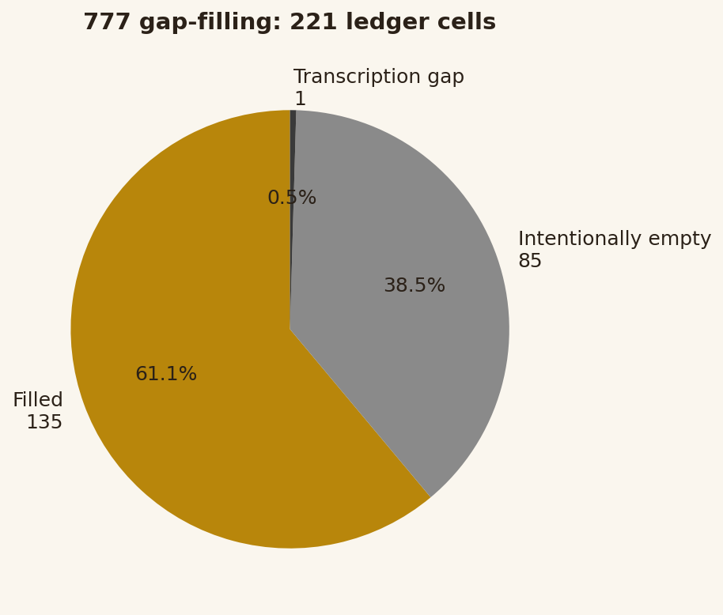
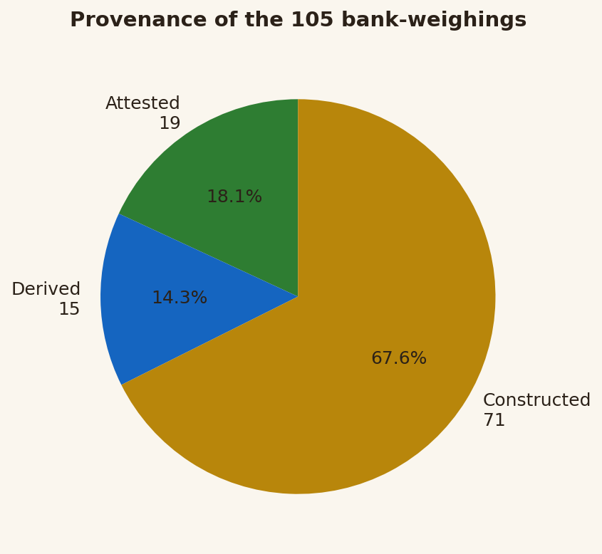
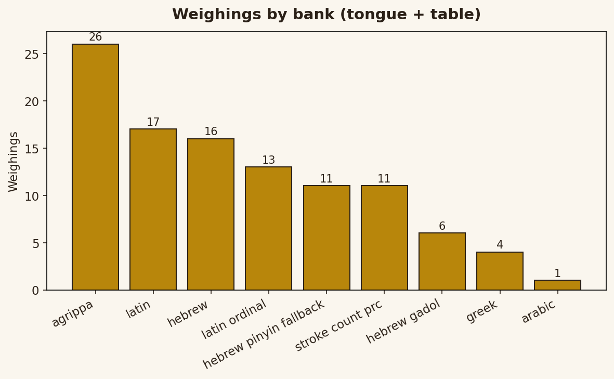
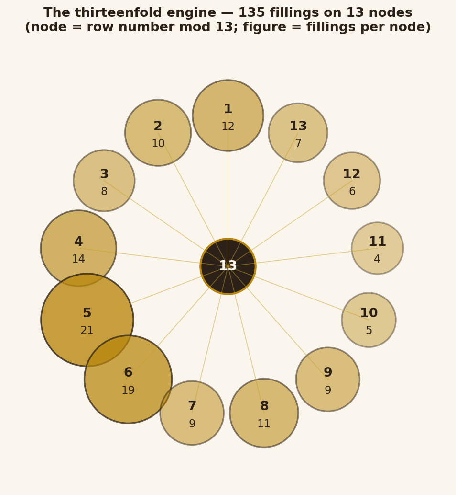

# THE THIRTEENFOLD ENGINE

## A working study of the 777 correspondences on thirteen nodes

> *"In the beginning was the Word... and the Word was the Law."*
> — the author's re-voicing of John 1:1 [Coinage: Johnathan "Qasparr (Κασπάρρ)" Monroe | Support: $axoneme]

**Date:** 2026-10-18

**93**

**Authorship & seal:** Johnathan 'Qasparr' (Κασπάρρ) Monroe, Keeper of the Secret Treasure — All Rights Reserved, Without Prejudice. Built by the Scribe at his order; findings, never doctrine — the red pen rules.

**Method:** Scientific Illuminism — hypothesis, method, observation, result; every correspondence weighed in its own tongue; every assignment carries its reasoning.

---

## I. THE TEACHING (revised)

Crowley's *777* left empty cells. On 2026-10-13, twenty-four PONTIFEX workers filled them the honest way: every candidate word weighed in its own tongue (Hebrew, Greek, Latin, Arabic, English...), every value tiered (attested / derived / constructed), every bridge claim tested against two honest banks. Result: **135 fillings, 85 cells certified intentionally empty, 1 transcription gap left open, zero honest two-bank bridges.** The zeros are reported as zeros.

This study arranges that work on **thirteen nodes** — the thirteenfold engine. Thirteen is the load-bearing number of the author's pattern work (his ruling, on record since the Axoneme essay). The assignment is mechanical: **node = ((row − 1) mod 13) + 1**. Row 1 sits on Node 1; row 13 on Node 13; row 14 on Node 1; row 26 on Node 13; row 0 on Node 13. No offices were invented for the nodes — the circle is the scribe's construction, a working arrangement, filed as constructed-tier. If the author's pen gives the nodes offices, the engine will carry them.

Three of the author's own findings govern the reading:

- **The Trinity of Law.** THE WORD = 93 (English ordinal), ΘΕΛΗΜΑ = 93 (Greek), ΑΓΑΠΗ = 93 (Greek) — three terms, two tongues, one number. Will, Love, and the Word that speaks them. Attested by his bridge doctrine.
- **NO + OZ = LILITH.** NO (29) + OZ (41) = 70 = LILITH (English ordinal). The refusal plus the strength it becomes equals her name. [His observation, verified.]
- **NO = 29 → 13.** 2+9+2 (the digits, plus the two letters) = 13 — the refusal reduces to the pattern's own number. [His reduction, verified.]

And his two framings open every well below: *"In the beginning was the Word... and the Word was the Law"* and *"Philosophy is the Fulfillment of the Law."*

**How to read the tables.** *Cell* — the column and row in Crowley's 777. *Proposal* — the candidate filling, flagged PONTIFEX-proposed. *Tier* — attested (the word exists in that tongue with that value), derived (computed by rule), constructed (our construction — hypothesis, never doctrine). *Bridge* — yes only when two honest banks agree; transliteration agreements and chance coincidences are named, never counted. *Reasoning* — why this word, in this tongue, in this cell. A value without its reasoning is not shippable — the author's standing rule.

> **Orthography correction 2026-10-27 (mirror notice).** Under the author's classical-orthography ruling (every U is V), this study — a mirror of `777-REVISED.md` — was corrected in step with the filing: entry names respelled and every Latin-bank value printed here reweighed. The pairs: ATVM 56 (filed ATUM 55), AQVA 41 (AQUA 40), VINVM 80 (VINUM 79), GLADIVS 74 (GLADIUS 73), FERRVM 82 (FERRUM 81), THVS 69 (THUS 68), SPECVLVM 112 (SPECULUM 110), LVNA 49 (LUNA 48), LVX 58 (LUX 57 — converging with the pre-existing LVX entry), OVVM 72 (OVUM 71), SPIRITVS 132 (SPIRITUS 131), JVPITER 100 (JUPITER 99), CONIVM 76 (CONIUM 75), CONIVM MACVLATVM 183 (CONIUM MACULATUM 180), CAPSICVM 86 (CAPSICUM 85), CAPSICVM ANNVVM 172 (CAPSICUM ANNUUM 169), MANDRAGORA OFFICINARVM 208 (MANDRAGORA OFFICINARUM 207), AVRIPIGMENTVM 169 (AURIPIGMENTUM 167), CROCVS MARTIS 160 (Crocus Martis 159), ALVM 48 (ALUM 47), BVDHA 37 (BUDHA 36), NERTHVS 106 (NERTHUS 105), SVRTR 97 (SURTR 96), TVI 51 (TUI 50), SVN 55 (SUN 54), BEELZEBVB 81 (Beelzebub 80), ZEVS 72 (ZEUS 71), SHAMHURISH 125 (124), MAYMUN 88 (87), and the Latin-bank transliterations MUDITA-SAMADHI 124 (123), MAHAKARUNA 90 (89), SAYUJYA 103 (102), VIBHUTI 92 (91), DHAMMACAKKHU 96 (95), GURU-DARSHANA 135 (133), TULA-BHAWANA 105 (104). Agrippa values stand everywhere (that bank reads U as V). Old values marked, not vanished — the canonical labeled corrections live in `777-REVISED.md`. The SURTR chance-flag (SURTR latin 96 = SOL hebrew 96) and the Brahmavihara/Sayujya 102 coincidence are superseded by SVRTR = 97 and SAYUJYA = 103 respectively.

---

## II. THE THIRTEENFOLD ENGINE — the circle and its nodes

**Hypothesis.** The 135 fillings can be worked as one engine if each is given a node.

**Method.** Node = ((row − 1) mod 13) + 1, taken on the row's leading number ("31 bis" → 31 → Node 5). Mechanical, auditable, reversible. Thirteen nodes because thirteen is the author's load-bearing number; mod-13 because theosophical reduction is his method.

**Observation.** The 135 fillings distribute: Node 1: 12, Node 2: 10, Node 3: 8, Node 4: 14, Node 5: 21, Node 6: 19, Node 7: 9, Node 8: 11, Node 9: 9, Node 10: 5, Node 11: 4, Node 12: 6, Node 13: 7. No node stands empty; the engine turns on all thirteen.

**Result.** The circle below. Node-by-node assignments follow, each row with its proposal and its reasoning in brief; full reasoning stands in Part III.

<h3>Node 1 — 12 fillings</h3>
<table border="1" cellpadding="4">
<tr><th>Cell</th><th>Proposal</th><th>Tiers</th><th>Reasoning (brief)</th></tr>
<tr><td>VI/14</td><td>נגה (Nogah) `[PONTIFEX-proposed 2026-10-13]`</td><td>attested</td><td>Crowley's marginal note at row 12, col VI: '[Planets follow Sephiroth, corresponding]' — the Hebrew planet name is already attested in this column (rows 1-10); …</td></tr>
<tr><td>VI/27</td><td>מאדים (Madim) `[PONTIFEX-proposed 2026-10-13]`</td><td>attested</td><td>Crowley's marginal note at row 12, col VI: '[Planets follow Sephiroth, corresponding]' — the Hebrew planet name is already attested in this column (rows 1-10); …</td></tr>
<tr><td>VIII/14</td><td>A'arab Zaraq `[PONTIFEX-proposed 2026-10-13]`</td><td></td><td>Derived: row-12 rubric + col VI row 7 'Sphere of Venus' under Netzach + row 7 qliphoth 'A'arab Zaraq'. Spelling ערב זרק: OCR printed 'qrz bru' (ayin dropped); a…</td></tr>
<tr><td>VIII/27</td><td>Golachab `[PONTIFEX-proposed 2026-10-13]`</td><td></td><td>Derived: row-12 rubric + col VI row 5 'Sphere of Mars' under Geburah + row 5 qliphoth 'Golachab'. Spelling גולחב OCR-recovered cleanly ('bjlwg' reversed). Weigh…</td></tr>
<tr><td>XXIV/27</td><td>Vision of Mangala `[PONTIFEX-proposed 2026-10-13]`</td><td>constructed, derived</td><td>MANGALA weighed; breakdown M13 A1 N14 G7 A1 L12 A1; skipped=none. CHANCE-FLAG: MANGALA=49=CHANDRA (Crowley's row-13 Moon word) in same bank, different words — c…</td></tr>
<tr><td>XLIII/27</td><td>Mustard seed [Sinapis] `[PONTIFEX-proposed 2026-10-13]`</td><td></td><td>Shares file labeled this cell XLII/27; XLII/27 is FILLED (Pepper...), the dot-run is XLIII/27 (verified vs source). Culpeper assigns Mustard to Mars; classical …</td></tr>
<tr><td>XLIV/14</td><td>Copper `[PONTIFEX-proposed 2026-10-13]`</td><td>derived</td><td>Venus's classical metal. Hebrew nehoshet attested. No two-bank agreement — no bridge.</td></tr>
<tr><td>XLVII/27</td><td>al-Ahmar (الأحمر, 'the Red One') `[PONTIFEX-proposed 2026-10…</td><td></td><td>Jinn king of Tuesday/Mars (Shams al-ma'arif / Kitab al-Bulhan / Sihr Muluk al-Jinn lineage; angel Samsama'il). Name attested; placement at Pe/Mars row construct…</td></tr>
<tr><td>CVIII/1</td><td>Satan `[PONTIFEX-proposed 2026-10-13]`</td><td>attested, constructed</td><td>Native tongue. breakdown: shin=300+teth=9+nun(final)=50; no skipped chars. No second bank agrees -&gt; single-bank value, not a bridge.</td></tr>
<tr><td>CXXXII/1</td><td>The Root of the Powers of Earth `[PONTIFEX-proposed 2026-10-…</td><td></td><td>Ace of Disks/Coins title attested in Crowley's Book of Thoth; exact parallel demanded by the column structure (CXXXIII/1 'The Root of the Powers of Fire', CXXXI…</td></tr>
<tr><td>CLXXXVII/1</td><td>AL (אל) `[PONTIFEX-proposed 2026-10-13]`</td><td></td><td>Weapon: Swastika or Fylfot Cross, Crown [The Lamp]. God-name of the Crown; the formula of Kether as AL. Greek AL=31 agrees via transliteration only (constructed…</td></tr>
<tr><td>CLXXXVII/27</td><td>GLADIVS `[PONTIFEX-proposed 2026-10-13]`</td><td></td><td>PRIMARY. Weapon (col XLI): The Sword; stone (col XL): Ruby, any red stone. unknown()=[].</td></tr>
</table>
<h3>Node 2 — 10 fillings</h3>
<table border="1" cellpadding="4">
<tr><th>Cell</th><th>Proposal</th><th>Tiers</th><th>Reasoning (brief)</th></tr>
<tr><td>XXIV/2</td><td>Savikalpa-samadhi `[PONTIFEX-proposed 2026-10-13]`</td><td></td><td>PRIMARY. Term attested: Crowley, Eight Lectures on Yoga (samprajnata/savikalpa samadhi, samadhi with seed/object). Fit: Chokmah=Wisdom counterpart to row 0's Ni…</td></tr>
<tr><td>XXIV/15</td><td>Success in Karma-yoga `[PONTIFEX-proposed 2026-10-13]`</td><td></td><td>Weighed compact KARMAYOGA; unknown() empty. karma-yoga attested (Bhagavad Gita); cell placement and transliteration constructed. 92 no row coincidence.</td></tr>
<tr><td>XLIV/15</td><td>CROCVS MARTIS `[PONTIFEX-proposed 2026-10-13]`</td><td>derived</td><td>Red iron oxide — 'saffron of Mars'; literally names the path's ruler. Attested (Webster 1913: colcothar=crocus Martis; RCPE dispensary lists it as a treatment).…</td></tr>
<tr><td>XLIV/28</td><td>ALVM `[PONTIFEX-proposed 2026-10-13]`</td><td></td><td>English native weighing; white Saturnine salt, astringent mineral drug of the old pharmacopoeia; Aquarius Saturn-ruled (classical); alum clarifies water - the W…</td></tr>
<tr><td>XLVI/15</td><td>LI `[PONTIFEX-proposed 2026-10-13]`</td><td>constructed</td><td>Heh (Aries, cardinal fire)/Consecrating Things: Li = Fire — consecration by fire/light; Aries is fire. Weighing: LI = 21 (L=12+I=9). Tier constructed: hypothesi…</td></tr>
<tr><td>XLVI/28</td><td>Khien [7] `[PONTIFEX-proposed 2026-10-13]`</td><td>constructed</td><td>Western power: 'Astrology'. Khien: breakdown K=11+H=8+I=9+E=5+N=14 | skipped: none</td></tr>
<tr><td>XLVII/15</td><td>كتمطمح `[PONTIFEX-proposed 2026-10-13]`</td><td></td><td>recovered from printed 777 (Celephais 2019 e-text; OCR visual-order decoded); unvoweled as printed; possible original-typeset errors per transcriber endnote; wo…</td></tr>
<tr><td>CVIII/2</td><td>Beelzebvb `[PONTIFEX-proposed 2026-10-13]`</td><td>attested, constructed</td><td>Biblical spelling baal-zevuv (2 Kings 1:2). The space is a separator, skipped openly (visible in unknown()). Single-bank value.</td></tr>
<tr><td>CLXXXVII/15</td><td>HA (הא) `[PONTIFEX-proposed 2026-10-13]`</td><td></td><td>Weapon: The Horns, Energy, the Burin. He spelled in full; the formula OF the path. 6.</td></tr>
<tr><td>CLXXXVII/28</td><td>THVS `[PONTIFEX-proposed 2026-10-13]`</td><td></td><td>PRIMARY. Weapon (col XLI): The Censer or Aspergillus; stone (col XL): Artificial Glass [[Chalcedony]]. The censer burns incense (Latin thus). unknown()=[].</td></tr>
</table>
<h3>Node 3 — 8 fillings</h3>
<table border="1" cellpadding="4">
<tr><th>Cell</th><th>Proposal</th><th>Tiers</th><th>Reasoning (brief)</th></tr>
<tr><td>XXIV/3</td><td>Mahakaruna `[PONTIFEX-proposed 2026-10-13]`</td><td></td><td>PRIMARY. Term attested: Mahayana Great Compassion. Fit: Binah=the Great Mother; Bhavani/Sakti in XXII. unknown()=[] verified.</td></tr>
<tr><td>XXXIII/16</td><td>SIF `[PONTIFEX-proposed 2026-10-13]`</td><td></td><td>Thor's wife, the queenly Asynja of the grain-field -- the Norse Hera/Demeter figure in the domestic-queen office (Frigg already used at row 3; XXXIV/16: [Here])…</td></tr>
<tr><td>XLIV/16</td><td>Malachite `[PONTIFEX-proposed 2026-10-13]`</td><td>constructed</td><td>Green copper carbonate — copper=Venus's metal, green=Venus's color; consecrated to Aphrodite/Venus in antiquity; used as cosmetic/medicine in ancient Egypt. Gre…</td></tr>
<tr><td>XLIV/29</td><td>IODINE `[PONTIFEX-proposed 2026-10-13]`</td><td></td><td>English native weighing; discovered in seaweed ash - the sea-born mineral drug for Pisces (the Fishes).</td></tr>
<tr><td>XLVI/16</td><td>KHAN `[PONTIFEX-proposed 2026-10-13]`</td><td>constructed</td><td>Vav (Taurus, fixed earth)/Physical Strength: Khan = the Mountain, Keeping Still — immovable physical strength. Weighing: KHAN = 34 (K=11+H=8+A=1+N=14). Tier con…</td></tr>
<tr><td>XLVI/29</td><td>Tvi [6] `[PONTIFEX-proposed 2026-10-13]`</td><td>constructed</td><td>Western power: 'Bewitchments, Casting Illusions'. Tvi: breakdown T=20+V=22+I=9 | skipped: none</td></tr>
<tr><td>XLVII/16</td><td>عطهم `[PONTIFEX-proposed 2026-10-13]`</td><td></td><td>recovered from printed 777 (Celephais 2019 e-text; OCR visual-order decoded); unvoweled as printed; possible original-typeset errors per transcriber endnote; wo…</td></tr>
<tr><td>CLXXXVII/29</td><td>SPECVLVM `[PONTIFEX-proposed 2026-10-13]`</td><td></td><td>PRIMARY. Weapon (col XLI): The Twilight of the Place and Magic Mirror; stone (col XL): Pearl. The mirror is the operative instrument. unknown()=[].</td></tr>
</table>
<h3>Node 4 — 14 fillings</h3>
<table border="1" cellpadding="4">
<tr><th>Cell</th><th>Proposal</th><th>Tiers</th><th>Reasoning (brief)</th></tr>
<tr><td>VI/30</td><td>שמש (Shemesh) `[PONTIFEX-proposed 2026-10-13]`</td><td>attested</td><td>Crowley's marginal note at row 12, col VI: '[Planets follow Sephiroth, corresponding]' — the Hebrew planet name is already attested in this column (rows 1-10); …</td></tr>
<tr><td>VIII/30</td><td>Thagiriron `[PONTIFEX-proposed 2026-10-13]`</td><td></td><td>Derived: row-12 rubric + col VI row 6 'Sphere of Sol' under Tiphareth + row 6 qliphoth 'Thagiriron'. Spelling תגרירון OCR-recovered cleanly ('}wryrgt' reversed)…</td></tr>
<tr><td>XXIV/4</td><td>Brahmavihara `[PONTIFEX-proposed 2026-10-13]`</td><td></td><td>PRIMARY. Term attested: Pali canon, the four divine abidings; Visuddhimagga: metta-bhavana issues in the brahma-abidings. Chesed=mercy is metta's own sephira. C…</td></tr>
<tr><td>XXIV/17</td><td>Success in Jnana-yoga `[PONTIFEX-proposed 2026-10-13]`</td><td></td><td>Weighed compact JNANAYOGA; unknown() empty. jnana-yoga attested (Gita); placement constructed. No row coincidence.</td></tr>
<tr><td>XXXIII/30</td><td>SOL `[PONTIFEX-proposed 2026-10-13]`</td><td></td><td>The sun goddess driving the sun-chariot -- the Helios parallel (XXXIV/30: Helios, Apollo).</td></tr>
<tr><td>XLIV/4</td><td>Tin `[PONTIFEX-proposed 2026-10-13]`</td><td>derived</td><td>Jupiter's classical planetary metal; fills the conspicuous hole left by Mars-&gt;Iron (5), Mercury-&gt;Mercury (8, 12), Saturn-&gt;Lead (32). Hebrew bedil attested (Num …</td></tr>
<tr><td>XLIV/17</td><td>Cinnabar `[PONTIFEX-proposed 2026-10-13]`</td><td>derived</td><td>Mercury sulphide — Mercury's own ore; the red sulphide suits Zain=Sword. Attested mineral drug (TCM zhusha, 2000+ yrs). Distinct from Mercury at 8/12 — Crowley …</td></tr>
<tr><td>XLIV/30</td><td>GOLD `[PONTIFEX-proposed 2026-10-13]`</td><td></td><td>English native weighing; gold is Sol's metal in every table (Agrippa). XLIV/1 has 'Aur. Pot.' (drinkable gold) at Kether; column duplicates metals freely (Mercu…</td></tr>
<tr><td>XLVI/4</td><td>TVI `[PONTIFEX-proposed 2026-10-13]`</td><td>constructed</td><td>Chesed/Vision of Love: Tui = the Joyous (Lake, trigram 2); love-joy correspondence. Single-bank latin; constructed; no bridge possible (Wade-Giles romanization,…</td></tr>
<tr><td>XLVI/17</td><td>SVN `[PONTIFEX-proposed 2026-10-13]`</td><td>constructed</td><td>Zayin (Gemini)/two places at once + Prophecy: Sun = Wind, the Gentle, penetrating everywhere — bilocation as wind; prophecy as the wind's voice. Weighing: SUN =…</td></tr>
<tr><td>XLVII/17</td><td>BARQAN (برقان) `[PONTIFEX-proposed 2026-10-13]`</td><td></td><td>Shams al-Ma'arif seven-kings tradition: king of Wednesday/Mercury. Row mapping via GD zodiac-planet (Gemini-Mercury). Breakdown: b2 r200 q100 a1 n50; unknown() …</td></tr>
<tr><td>XLVII/30</td><td>al-Mudhhib (المذهب, 'the Gilder') `[PONTIFEX-proposed 2026-1…</td><td></td><td>Jinn king of Sunday/Sun (variant spellings al-Madhab / al-Muth-hib; angel Ruqya'il). Breakdown: ا1+ل30+م40+ذ700+ه5+ب2=778; unknown() clean. Name attested; place…</td></tr>
<tr><td>CLXXXV/4</td><td>5 `[PONTIFEX-proposed 2026-10-13]`</td><td></td><td>LIII prints [ε] (bracketed = doubtful) with empty numeration — verified against PDF p.25 at 3x zoom. ε=5 Milesian attested; the cell inherits the letter's doubt…</td></tr>
<tr><td>CLXXXVII/17</td><td>ZIN (זין) `[PONTIFEX-proposed 2026-10-13]`</td><td></td><td>Weapon: The Tripod. Zain spelled in full; the formula OF the path. 67.</td></tr>
</table>
<h3>Node 5 — 21 fillings</h3>
<table border="1" cellpadding="4">
<tr><th>Cell</th><th>Proposal</th><th>Tiers</th><th>Reasoning (brief)</th></tr>
<tr><td>III/31 bis</td><td>Tooth `[PONTIFEX-proposed 2026-10-13]`</td><td>attested</td><td>Deterministic: row 31 col III prints 'Tooth'. Weighing the gloss in the native English banks. | value=78 | skipped: none</td></tr>
<tr><td>VIII/31</td><td>Paimon `[PONTIFEX-proposed 2026-10-13]`</td><td></td><td>Derived: row-11 rubric '[Elements. See Col. LXVIII.]' + LXVIII row 31 'Paimon' (The Demon Kings). Agrippa Latin bank; P60+A1+I9+M30+O50+N40=190; case-folded. un…</td></tr>
<tr><td>XX/31 bis</td><td>Atum `[PONTIFEX-proposed 2026-10-13]`</td><td></td><td>Atum (Tum) the Complete One, self-begotten, containing all — cf. XIX/23 'Tum'. Discarded: Amoun (already XX/4, XX/21; air not spirit), Sphinx (synthesizes four,…</td></tr>
<tr><td>XXI/18</td><td>Hormakhu — the Forehead `[PONTIFEX-proposed 2026-10-13]`</td><td></td><td>Egyptian god-name weighed in Hebrew fallback (transliteration הורמכו is the worker's construction). Reasoning: Hormakhu = Horus of the Horizon (col. XX); the br…</td></tr>
<tr><td>XXIV/5</td><td>Amata `[PONTIFEX-proposed 2026-10-13]`</td><td></td><td>PRIMARY. Term attested: Pali canon, the Deathless=Nibbana; deliberate contrast with the Death meditation object. Geburah=severity/judgment, the destroyer aspect…</td></tr>
<tr><td>XXIV/18</td><td>Soma-bhawana `[PONTIFEX-proposed 2026-10-13]`</td><td></td><td>Weighed SOMABHAWANA; unknown() empty. -bhawana grammar matches rows 11/23/31; soma attested, compound constructed. No row coincidence.</td></tr>
<tr><td>XXXIII/31</td><td>SVRTR `[PONTIFEX-proposed 2026-10-13]`</td><td></td><td>The fire giant of Muspelheim, flaming sword at Ragnarok -- the fire office (XXXIV/31: Hades). Chance-flag: SURTR latin 96 = SOL hebrew 96 [superseded 2026-10-27: SVRTR = 97 under the classical-orthography ruling], cross-word coincidenc…</td></tr>
<tr><td>XXXIII/31 bis</td><td>ODIN `[PONTIFEX-proposed 2026-10-13]`</td><td></td><td>odhr = ecstatic frenzy; Odin is 'the frenzied one', lord of the ecstasy Iacchus personifies (XXXIV/31 bis: Iacchus). Reuse noted: Odin already at rows 2 and 8 -…</td></tr>
<tr><td>XLIII/31</td><td>Ginger (Zingiber officinale) -- ZINGIBER `[PONTIFEX-proposed…</td><td></td><td>Proposal: Ginger for Shin=Fire=Aeon: the heating/pungent drug; the same word in Latin and Hebrew (zingiber/zangvil via Gk zingiberis). Hebrew zangvil=modern Heb…</td></tr>
<tr><td>XLIV/18</td><td>Coral `[PONTIFEX-proposed 2026-10-13]`</td><td>constructed</td><td>Corallium rubrum praeparatum — sea-born mineral drug of the watery Moon-ruled sign; 'formerly used in medicine' (Pereira's Materia Medica). Hebrew almog atteste…</td></tr>
<tr><td>XLVI/5</td><td>KBN `[PONTIFEX-proposed 2026-10-13]`</td><td>constructed</td><td>Geburah/Vision of Power: Kbn (Chên) = Thunder, the Arousing — power manifest, severity's shock. CHANCE-FLAG: value 27 = 3^3, filed as coincidence, not significa…</td></tr>
<tr><td>XLVI/18</td><td>KAN `[PONTIFEX-proposed 2026-10-13]`</td><td>constructed</td><td>Cheth (Cancer, cardinal water)/Casting Enchantments: Kan = Water — enchantment as water-magic (moon-tide). Repeats row 9's token; the column already repeats tok…</td></tr>
<tr><td>XLVI/31 bis</td><td>Svn [3] `[PONTIFEX-proposed 2026-10-13]`</td><td>constructed</td><td>Western power: 'Invisibility, Transformations, Vision of the Genius'. Svn: breakdown S=19+V=22+N=14 | skipped: none</td></tr>
<tr><td>XLVII/18</td><td>طيهم `[PONTIFEX-proposed 2026-10-13]`</td><td></td><td>recovered from printed 777 (Celephais 2019 e-text; OCR visual-order decoded); unvoweled as printed; possible original-typeset errors per transcriber endnote; wo…</td></tr>
<tr><td>XLVII/31 bis</td><td>JANN (جان) `[PONTIFEX-proposed 2026-10-13]`</td><td></td><td>Primordial jinn, Qur'an 15:27 (al-jann created before man, of scorching fire). Name attested; mapping to the Spirit row is derived. unknown() clean.</td></tr>
<tr><td>LVI/31 bis</td><td>The River of Eden, undivided source (Gen. 2:10) `[PONTIFEX-p…</td><td></td><td>Shares file labeled this cell LV/31 bis; LV/31 bis is FILLED ('A Spirit, Hearing'), the dot-run is LVI/31 bis (verified vs source). Gen 2:10: one river went out…</td></tr>
<tr><td>LVII/31 bis</td><td>Tokh (the Midst) `[PONTIFEX-proposed 2026-10-13]`</td><td></td><td>Shares file labeled LV/31 bis (see LVI note). Fifth quarter = the Centre; biblical Hebrew תוך ('midst') fits the column's Hebrew entries (Mezrach, Maareb, Darom…</td></tr>
<tr><td>LVIII/31 bis</td><td>Elexarpeh, Comananu, Tabitom - the Three Angels ruling the T…</td><td></td><td>Shares file labeled LV/31 bis (see LVI note). GD Portal-grade Enochian invocation (Regardie, Ceremonial Magic): 'These are the three Angels who rule over the Ta…</td></tr>
<tr><td>LXIII/31 bis</td><td>Adam Kadmon, the fifth world above Atziluth `[PONTIFEX-propo…</td><td></td><td>Lurianic fifth world (attested concept); placement at 31 bis derived structurally. Weighed אדם קדמון.</td></tr>
<tr><td>CLXXXVII/31</td><td>IGNIS `[PONTIFEX-proposed 2026-10-13]`</td><td></td><td>PRIMARY. Weapon (col XLI): The Wand or Lamp, Pyramid of B [[The Thurible]]; stone (col XL): Fire Opal. Fire-word for the fire letter. unknown()=[].</td></tr>
<tr><td>CLXXXVII/31 bis</td><td>OVVM `[PONTIFEX-proposed 2026-10-13]`</td><td></td><td>PRIMARY. Weapon (col XLI): [[The Winged Egg]]; stone (col XL): Black Diamond. The egg of spirit. unknown()=[].</td></tr>
</table>
<h3>Node 6 — 19 fillings</h3>
<table border="1" cellpadding="4">
<tr><th>Cell</th><th>Proposal</th><th>Tiers</th><th>Reasoning (brief)</th></tr>
<tr><td>III/32 bis</td><td>Tau (as Egyptian) `[PONTIFEX-proposed 2026-10-13]`</td><td>attested</td><td>Deterministic: col III is 'English of Col. II'; row 32 prints 'Tau (as Egyptian)'. Weighing the gloss in the native English banks. | value=159 | skipped: [' ', …</td></tr>
<tr><td>VI/32</td><td>שבתאי (Shabbathai) `[PONTIFEX-proposed 2026-10-13]`</td><td>attested</td><td>Crowley's marginal note at row 12, col VI: '[Planets follow Sephiroth, corresponding]' — the Hebrew planet name is already attested in this column (rows 1-10); …</td></tr>
<tr><td>VIII/32</td><td>Satariel `[PONTIFEX-proposed 2026-10-13]`</td><td></td><td>Derived: row-12 rubric + col VI row 3 'Sphere of Saturn' under Binah + row 3 qliphoth 'Satariel'. Spelling סתאריאל OCR-recovered cleanly ('layratas' reversed). …</td></tr>
<tr><td>VIII/32 bis</td><td>Amaimon `[PONTIFEX-proposed 2026-10-13]`</td><td></td><td>Derived: row-11 rubric '[Elements. See Col. LXVIII.]' + LXVIII row 32 bis 'Amaimon' (The Demon Kings). Agrippa Latin bank; A1+M30+A1+I9+M30+O50+N40=161; case-fo…</td></tr>
<tr><td>XX/32 bis</td><td>Seb `[PONTIFEX-proposed 2026-10-13]`</td><td></td><td>Egyptian earth-god (Geb); the direct practical attribution for Earth. Chance-flag: 26 = YHVH in Latin ordinal (coincidence, single bank, not a bridge).</td></tr>
<tr><td>XXIV/19</td><td>Tejo-bhawana `[PONTIFEX-proposed 2026-10-13]`</td><td></td><td>Weighed TEJOBHAWANA; unknown() empty. tejas=radiance; contemplation of radiance fits Leo/Sun/Lust. Overlap with Agni-bhawana (row 31) flagged: different facet (…</td></tr>
<tr><td>XXIV/32</td><td>Vision of Shani `[PONTIFEX-proposed 2026-10-13]`</td><td>constructed, derived</td><td>SHANI weighed; breakdown S19 H8 A1 N14 I9; skipped=none.</td></tr>
<tr><td>XXXIII/6</td><td>BALDR `[PONTIFEX-proposed 2026-10-13]`</td><td></td><td>The beautiful slain-and-returning god -- Adonis/Dionysus parallel to XXXIV/6 (Iacchus, Apollo, Adonis, Dionysus, Bacchus). Freyr considered, declined: Baldr is …</td></tr>
<tr><td>XXXIII/32 bis</td><td>NERTHVS `[PONTIFEX-proposed 2026-10-13]`</td><td></td><td>Tacitus's Terra Mater -- the same source-tradition as XXXIII/27 Tuisco (XXXIV/32 bis: [Demeter] [[Gaia]]). Erda weighed as alternative.</td></tr>
<tr><td>XLIII/32 bis</td><td>Mandrake (Mandragora officinarum) -- MANDRAGORA `[PONTIFEX-p…</td><td></td><td>Proposal: Mandrake for 32 bis=Earth: the magical earth-root, narcotic ('dull and heavy' -- cf. XLII/32 bis 'all Dull and Heavy Odours'). Hebrew duda'im=Biblical…</td></tr>
<tr><td>XLIV/6</td><td>Gold `[PONTIFEX-proposed 2026-10-13]`</td><td>derived</td><td>The Sun's metal. Aur. Pot. at row 1 (Kether) is a gold PREPARATION; this is the metal proper of the solar sephira — not duplicative in kind. Hebrew zahab attest…</td></tr>
<tr><td>XLIV/19</td><td>ORPIMENT `[PONTIFEX-proposed 2026-10-13]`</td><td></td><td>English native weighing; golden alchemical pigment, solar colour for Leo; pairs with Arsenic at XLIV/7 as its parent metal's ore. Pliny's Latin AVRIPIGMENTVM al…</td></tr>
<tr><td>XLVI/19</td><td>Kbn [1] `[PONTIFEX-proposed 2026-10-13]`</td><td>constructed</td><td>Western power: 'Power of Training Wild Beasts'. Kbn: breakdown K=11+B=2+N=14 | skipped: none</td></tr>
<tr><td>XLVII/19</td><td>حللد `[PONTIFEX-proposed 2026-10-13]`</td><td></td><td>recovered from printed 777 (Celephais 2019 e-text; OCR visual-order decoded); unvoweled as printed; possible original-typeset errors per transcriber endnote; wo…</td></tr>
<tr><td>XLVII/32</td><td>Maymun (ميمون, 'the Fortunate') `[PONTIFEX-proposed 2026-10-…</td><td></td><td>Jinn king of Saturday/Saturn (angel Kasfa'il). Breakdown: م40+ي10+م40+و6+ن50=146; unknown() clean. Note: ميمون is also Arabic for 'baboon/monkey' - cf. Crowley'…</td></tr>
<tr><td>XLVII/32 bis</td><td>AMAIMON `[PONTIFEX-proposed 2026-10-13]`</td><td></td><td>Attested king of the earth quarter (Goetia/Pseudomonarchia; cf. source line 1212 'Nephesh Amaimon' at 32 bis). The Arabic seven-kings tradition names no earth-k…</td></tr>
<tr><td>LI/32 bis</td><td>T (Tau, Coptic) - as row 32 `[PONTIFEX-proposed 2026-10-13]`</td><td></td><td>Shares file labeled this cell XLVIII/32 bis; line 1107 is in the L/LI table (verified vs source). Col I reuses Tau for 32 bis (printed, attested); LI is keyed C…</td></tr>
<tr><td>CLXXXVII/32</td><td>FALX `[PONTIFEX-proposed 2026-10-13]`</td><td></td><td>PRIMARY. Weapon (col XLI): A Sickle; stone (col XL): Onyx. Saturn's reaping instrument. unknown()=[].</td></tr>
<tr><td>CLXXXVII/32 bis</td><td>SAL `[PONTIFEX-proposed 2026-10-13]`</td><td></td><td>PRIMARY. Weapon (col XLI): The Pantacle or [[Bread and]] Salt; stone (col XL): Salt. NOTE: Latin ordinal SAL=32 echoes the row number (32 bis) — chance-flagged …</td></tr>
</table>
<h3>Node 7 — 9 fillings</h3>
<table border="1" cellpadding="4">
<tr><th>Cell</th><th>Proposal</th><th>Tiers</th><th>Reasoning (brief)</th></tr>
<tr><td>XXI/20</td><td>Heru-pa-Kraath — the Tongue `[PONTIFEX-proposed 2026-10-13]`</td><td></td><td>Egyptian god-name in Hebrew fallback (transliteration חרופאקראת, worker's construction). Reasoning: the Babe's finger-to-lips gesture (col. XX) stills the tongu…</td></tr>
<tr><td>XXIV/7</td><td>Sayujya `[PONTIFEX-proposed 2026-10-13]`</td><td></td><td>PRIMARY. Term attested: Hindu four muktis (salokya/samipya/sarupya/sayujya); sayujya=union with the deity. Fit: meditation on god-forms issues in union. CHANCE-…</td></tr>
<tr><td>XXIV/20</td><td>Success in Kriya-yoga `[PONTIFEX-proposed 2026-10-13]`</td><td></td><td>Weighed KRIYAYOGA; unknown() empty. kriya-yoga attested (Patanjali); Virgo=discrimination/purity, Hermit=discipline.</td></tr>
<tr><td>XLIV/20</td><td>CINNABAR `[PONTIFEX-proposed 2026-10-13]`</td><td></td><td>English native weighing; mercury ore (HgS) - Virgo is Mercury-ruled, Mercury metal already at XLIV/8 and XLIV/12, its ore is the column-suited step.</td></tr>
<tr><td>XLVI/7</td><td>TVI `[PONTIFEX-proposed 2026-10-13]`</td><td>constructed</td><td>Netzach/Vision of Beauty Triumphant: Tui = the Joyous; beauty's triumph is joy (Venusian). Single-bank latin; constructed. Weighing: TVI = 51 (T=20+V=22+I=9). T…</td></tr>
<tr><td>XLVI/20</td><td>Kbn [1] `[PONTIFEX-proposed 2026-10-13]`</td><td>constructed</td><td>Western power: 'Invisibility, Parthenogenesis, Initiation (?)'. Kbn: breakdown K=11+B=2+N=14 | skipped: none</td></tr>
<tr><td>XLVII/20</td><td>ةمطحيسم `[PONTIFEX-proposed 2026-10-13]`</td><td></td><td>recovered from printed 777 (Celephais 2019 e-text; OCR visual-order decoded); unvoweled as printed; possible original-typeset errors per transcriber endnote; wo…</td></tr>
<tr><td>CLXXXV/7</td><td>5 `[PONTIFEX-proposed 2026-10-13]`</td><td></td><td>Same as CLXXXV/4: LIII prints [ε] bracketed, numeration empty. ε=5 Milesian; placement doubtful (ε already row 15; surplus placement). Filling follows the print…</td></tr>
<tr><td>CLXXXVII/20</td><td>YVD (יוד) `[PONTIFEX-proposed 2026-10-13]`</td><td></td><td>Weapon: The Lamp and Wand (Virile Force reserved), the Bread [Lotus Wand]. Yod spelled in full; the formula OF the path — the secret Fire. 20.</td></tr>
</table>
<h3>Node 8 — 11 fillings</h3>
<table border="1" cellpadding="4">
<tr><th>Cell</th><th>Proposal</th><th>Tiers</th><th>Reasoning (brief)</th></tr>
<tr><td>VI/21</td><td>צדק (Tzedeq) `[PONTIFEX-proposed 2026-10-13]`</td><td>attested</td><td>Crowley's marginal note at row 12, col VI: '[Planets follow Sephiroth, corresponding]' — the Hebrew planet name is already attested in this column (rows 1-10); …</td></tr>
<tr><td>VIII/21</td><td>Gha'agsheklah `[PONTIFEX-proposed 2026-10-13]`</td><td></td><td>Derived: row-12 rubric + col VI row 4 'Sphere of Jupiter' under Chesed + row 4 qliphoth 'Gha'agsheklah'. Spelling עוגשכלה: OCR printed 'hlksug' (gimel dropped);…</td></tr>
<tr><td>XXIV/8</td><td>Iddhi `[PONTIFEX-proposed 2026-10-13]`</td><td></td><td>PRIMARY. Term attested: Pali canon, the supernormal powers (ten iddhis); mastery of the analyzed elements. Hod=intellect/analysis. unknown()=[] verified.</td></tr>
<tr><td>XXIV/21</td><td>Guru-darshana `[PONTIFEX-proposed 2026-10-13]`</td><td></td><td>Weighed GURUDARSHANA; unknown() empty. Brihaspati/Jupiter = Guru of the devas; guru-darshana genuine concept. 133 also = JNANAYOGA Hebrew (different pair) — coi…</td></tr>
<tr><td>XLIV/21</td><td>TIN `[PONTIFEX-proposed 2026-10-13]`</td><td></td><td>English native weighing; tin is Jupiter's metal in the full classical table (Agrippa).</td></tr>
<tr><td>XLVI/8</td><td>LI `[PONTIFEX-proposed 2026-10-13]`</td><td>constructed</td><td>Hod/Vision of Splendour (Ezekiel): Li = Fire, the Clinging, radiance — Ezekiel's vision is fiery splendour; Hod/Mercury as intellectual radiance. Strongest fit …</td></tr>
<tr><td>XLVII/8</td><td>Barqan (برقان) `[PONTIFEX-proposed 2026-10-13]`</td><td></td><td>Name attested in Arabic grimoire tradition (Shams al-ma'arif lineage) as the jinn king of Wednesday/Mercury ("Two Thunders"); row-correspondence Hod/Mercury-&gt;Ba…</td></tr>
<tr><td>XLVII/21</td><td>حديوس `[PONTIFEX-proposed 2026-10-13]`</td><td></td><td>recovered from printed 777 (Celephais 2019 e-text; OCR visual-order decoded); unvoweled as printed; possible original-typeset errors per transcriber endnote; wo…</td></tr>
<tr><td>LIII/8</td><td>sampi (900) `[PONTIFEX-proposed 2026-10-13]`</td><td></td><td>Rows 4-10 are the Greek hundred-letters in order (500-1000); row 8 = 900 = sampi, in ptk's attested GREEK bank (epissemones included). Parallel (NOT a bridge - …</td></tr>
<tr><td>CLXXXVII/8</td><td>AMEN (אמן) `[PONTIFEX-proposed 2026-10-13]`</td><td></td><td>Weapon: The Names and Versicles and Apron. The Versicles conclude in Amen; the formula of affirmation sealing the Names.</td></tr>
<tr><td>CLXXXVII/21</td><td>KPH (כף) `[PONTIFEX-proposed 2026-10-13]`</td><td></td><td>Weapon: The Sceptre. Kaph spelled in full; the formula OF the path. 100.</td></tr>
</table>
<h3>Node 9 — 9 fillings</h3>
<table border="1" cellpadding="4">
<tr><th>Cell</th><th>Proposal</th><th>Tiers</th><th>Reasoning (brief)</th></tr>
<tr><td>XXI/22</td><td>Maat — the Right Ear `[PONTIFEX-proposed 2026-10-13]`</td><td></td><td>Egyptian god-name in Hebrew fallback (transliteration מעת, worker's construction). Reasoning: Maat = truth/the balance (col. XX); justice hears testimony; compl…</td></tr>
<tr><td>XXIV/9</td><td>Sotapatti `[PONTIFEX-proposed 2026-10-13]`</td><td></td><td>PRIMARY. Term attested: Pali canon, stream-entry; Yesod=foundation, entry into the stream is the foundation of the noble path. unknown()=[] verified.</td></tr>
<tr><td>XXIV/22</td><td>Tula-bhawana `[PONTIFEX-proposed 2026-10-13]`</td><td></td><td>Weighed TULABHAWANA; unknown() empty. Tula=Libra in Jyotisha (attested sign name); 'contemplation of the Balance' — compound constructed, tightest row-fit of th…</td></tr>
<tr><td>XLIV/22</td><td>COPPER `[PONTIFEX-proposed 2026-10-13]`</td><td></td><td>English native weighing; copper is Venus's metal (Agrippa); Libra Venus-ruled.</td></tr>
<tr><td>XLVI/9</td><td>KAN `[PONTIFEX-proposed 2026-10-13]`</td><td>constructed</td><td>Yesod (Moon)/Machinery of the Universe: Kan = Water, the Abysmal — moon/water is the oldest correspondence; consistent with row 13's 'Kan and Khwan' on Gimel, t…</td></tr>
<tr><td>XLVI/22</td><td>Khien and Khwbn `[PONTIFEX-proposed 2026-10-13]`</td><td>constructed</td><td>Western power: 'Works of Justice and Equilibrium'. Pair-form per Crowley's 'Kan and Khwan' / 'Li and Khien' precedent. Khien: breakdown K=11+H=8+I=9+E=5+N=14 | …</td></tr>
<tr><td>XLVII/9</td><td>Murrah (مرة) `[PONTIFEX-proposed 2026-10-13]`</td><td></td><td>Name attested in Arabic grimoire tradition as the jinn king of Monday/Moon (Murra ibn al-Harith); variant: some accounts give al-Abyad (the White One) for Monda…</td></tr>
<tr><td>XLVII/22</td><td>ZAWBAAH (زوبعة) `[PONTIFEX-proposed 2026-10-13]`</td><td></td><td>Friday/Venus king; fandom and Kitab al-Bulhan agree. Bank skips ta-marbuta (visible via unknown()); conventional marbuta=5 gives 90. Reported as spread 85/90, c…</td></tr>
<tr><td>CLXXXVII/22</td><td>LMD (למד) `[PONTIFEX-proposed 2026-10-13]`</td><td></td><td>Weapon: The Cross of Equilibrium. Lamed spelled in full; the formula OF the path. 74.</td></tr>
</table>
<h3>Node 10 — 5 fillings</h3>
<table border="1" cellpadding="4">
<tr><th>Cell</th><th>Proposal</th><th>Tiers</th><th>Reasoning (brief)</th></tr>
<tr><td>VIII/23</td><td>Ariton `[PONTIFEX-proposed 2026-10-13]`</td><td></td><td>Derived: row-11 rubric '[Elements. See Col. LXVIII.]' + LXVIII row 23 'Ariton' (The Demon Kings). Latin-script Lemegeton name weighed in Agrippa's Latin table (…</td></tr>
<tr><td>XXXIII/10</td><td>JORD `[PONTIFEX-proposed 2026-10-13]`</td><td></td><td>The Norse earth goddess (Thor's mother), the inhabited earth. Alternative NERTHUS weighed below; primary kept here to avoid double-booking 32 bis.</td></tr>
<tr><td>XXXIII/23</td><td>NJORD `[PONTIFEX-proposed 2026-10-13]`</td><td></td><td>God of sea, wind and seafaring -- the Poseidon parallel (XXXIV/23: Poseidon). Aegir weighed as alternative.</td></tr>
<tr><td>XLVII/23</td><td>حوميلم `[PONTIFEX-proposed 2026-10-13]`</td><td></td><td>recovered from printed 777 (Celephais 2019 e-text; OCR visual-order decoded); unvoweled as printed; possible original-typeset errors per transcriber endnote; wo…</td></tr>
<tr><td>CLXXXVII/23</td><td>AQVA `[PONTIFEX-proposed 2026-10-13]`</td><td></td><td>PRIMARY. Weapon (col XLI): The Cup and Cross of Suffering, the Wine [[Water of Lustration]]; stone (col XL): Beryl or Aquamarine. Water-word for the water lette…</td></tr>
</table>
<h3>Node 11 — 4 fillings</h3>
<table border="1" cellpadding="4">
<tr><th>Cell</th><th>Proposal</th><th>Tiers</th><th>Reasoning (brief)</th></tr>
<tr><td>XLIII/24</td><td>Hemlock (Conium maculatum) -- CONIVM `[PONTIFEX-proposed 202…</td><td></td><td>Proposal: Hemlock for Nun=Scorpio=Death: the classic death-poison (Socrates), Scorpio=putrefaction. Hebrew rosh=KJV 'hemlock' (Hos 10:4; Amos 6:12); Greek konei…</td></tr>
<tr><td>XLIV/11</td><td>Sal Volatile `[PONTIFEX-proposed 2026-10-13]`</td><td>constructed</td><td>Ammonium carbonate — smelling salts, the INHALED drug; volatile=flying=airy. Name attested (New Latin sal volatile). Placement reasoning is the scribe's — const…</td></tr>
<tr><td>XLVI/24</td><td>Khan [2] `[PONTIFEX-proposed 2026-10-13]`</td><td>constructed</td><td>Western power: 'Necromancy'. Khan: breakdown K=11+H=8+A=1+N=14 | skipped: none</td></tr>
<tr><td>CLXXXVII/11</td><td>ALPH (אלף) `[PONTIFEX-proposed 2026-10-13]`</td><td></td><td>Weapon: The Dagger or Fan. Aleph spelled in full; the formula OF the path itself. 111.</td></tr>
</table>
<h3>Node 12 — 6 fillings</h3>
<table border="1" cellpadding="4">
<tr><th>Cell</th><th>Proposal</th><th>Tiers</th><th>Reasoning (brief)</th></tr>
<tr><td>XXI/25</td><td>Nephthys — the Knees `[PONTIFEX-proposed 2026-10-13]`</td><td></td><td>Egyptian god-name in Hebrew fallback (transliteration נפתיס, worker's construction). Reasoning: Nephthys the mourner (col. XIX) kneels at the bier of Osiris; th…</td></tr>
<tr><td>XXIV/12</td><td>Patibhaga-nimitta `[PONTIFEX-proposed 2026-10-13]`</td><td></td><td>PRIMARY. Term attested: Visuddhimagga, the counterpart sign -- the named result-milestone of kasina practice; Crowley discusses nimittas in Eight Lectures. Beth…</td></tr>
<tr><td>XLIII/25</td><td>Sage (Salvia officinalis) -- SALVIA `[PONTIFEX-proposed 2026…</td><td></td><td>Proposal: Sage for Samekh=Sagittarius=Temperance/Art: Culpeper's English Physitian lists Sage under Jupiter (verified plant list); Sagittarius is Jupiter's diur…</td></tr>
<tr><td>XLVI/25</td><td>Khan and Li `[PONTIFEX-proposed 2026-10-13]`</td><td>constructed</td><td>Western power: 'Transmutations [[Vision of Universal Peacock]]'. Pair-form per Crowley's 'Kan and Khwan' / 'Li and Khien' precedent. Khan: breakdown K=11+H=8+A=…</td></tr>
<tr><td>XLVII/25</td><td>SHAMHURISH (شمهورش) `[PONTIFEX-proposed 2026-10-13]`</td><td></td><td>Thursday/Jupiter king; chief judge of the jinn in the tradition. unknown() clean.</td></tr>
<tr><td>CLXXXVII/12</td><td>BITH (בית) `[PONTIFEX-proposed 2026-10-13]`</td><td></td><td>Weapon: The Wand or Caduceus. Beth spelled in full; the formula OF the path. 412.</td></tr>
</table>
<h3>Node 13 — 7 fillings</h3>
<table border="1" cellpadding="4">
<tr><th>Cell</th><th>Proposal</th><th>Tiers</th><th>Reasoning (brief)</th></tr>
<tr><td>VI/13</td><td>לבנה (Levanah) `[PONTIFEX-proposed 2026-10-13]`</td><td>attested</td><td>Crowley's marginal note at row 12, col VI: '[Planets follow Sephiroth, corresponding]' — the Hebrew planet name is already attested in this column (rows 1-10); …</td></tr>
<tr><td>VIII/13</td><td>Gamaliel `[PONTIFEX-proposed 2026-10-13]`</td><td></td><td>Derived, not invented: row-12 rubric '[Planets follow Sephiroth]' + col VI row 9 'Sphere of Luna' under Yesod + row 9 qliphoth 'Gamaliel'. Spelling גמיאל OCR-re…</td></tr>
<tr><td>XXXIII/13</td><td>MANI `[PONTIFEX-proposed 2026-10-13]`</td><td></td><td>PRIMARY: Mani is the Norse moon personified -- the direct lunar deity for this row (XXXIV/13: Artemis, Hekate). Male where the Greek pair is female; noted hones…</td></tr>
<tr><td>XLIV/13</td><td>Lunar Caustic `[PONTIFEX-proposed 2026-10-13]`</td><td>derived</td><td>Silver nitrate — 'lunar' from alchemists' luna=Moon/silver; literally names the path's planet. Attested (MW: 'silver nitrate ... for use as a caustic'). Cross-r…</td></tr>
<tr><td>XLIV/26</td><td>ANTIMONY `[PONTIFEX-proposed 2026-10-13]`</td><td></td><td>English native weighing; Saturnine black mineral; Capricorn Saturn-ruled (classical); antimony = kohl, the Eye-medicine (Ayin=Eye) - double fitness.</td></tr>
<tr><td>XLVI/26</td><td>Khan [2] `[PONTIFEX-proposed 2026-10-13]`</td><td>constructed</td><td>Western power: 'The Witches' Sabbath so-called, the Evil Eye'. Khan: breakdown K=11+H=8+A=1+N=14 | skipped: none</td></tr>
<tr><td>XLVII/26</td><td>MAYMUN (ميمون) `[PONTIFEX-proposed 2026-10-13]`</td><td></td><td>Saturday/Saturn king. unknown() clean.</td></tr>
</table>

---

## III. THE FULL TABLES — all 135 fillings

<table border="1" cellpadding="4">
<tr><th>Cell</th><th>Proposal</th><th>Banks (value [tier])</th><th>Bridge</th><th>Reasoning</th></tr>
<tr><td>III/31 bis&lt;br/&gt;Shin repeated — Spirit/Earth added row</td><td>Tooth `[PONTIFEX-proposed 2026-10-13]`</td><td>latin_ordinal: 78 [attested]; agrippa: 308 [attested]</td><td>none.</td><td>Deterministic: row 31 col III prints 'Tooth'. Weighing the gloss in the native English banks. | value=78 | skipped: none</td></tr>
<tr><td>III/32 bis&lt;br/&gt;Tau repeated — Spirit/Earth added row</td><td>Tau (as Egyptian) `[PONTIFEX-proposed 2026-10-13]`</td><td>latin_ordinal: 159 [attested]; agrippa: 1014 [attested]</td><td>none.</td><td>Deterministic: col III is 'English of Col. II'; row 32 prints 'Tau (as Egyptian)'. Weighing the gloss in the native English banks. | value=159 | skipped: [' ', '(', ')']</td></tr>
<tr><td>VI/13&lt;br/&gt;Gimel — path of Luna (VII: Luna)</td><td>לבנה (Levanah) `[PONTIFEX-proposed 2026-10-13]`</td><td>hebrew: 87 [attested]; hebrew_gadol: 87 [attested]</td><td>none.</td><td>Crowley's marginal note at row 12, col VI: '[Planets follow Sephiroth, corresponding]' — the Hebrew planet name is already attested in this column (rows 1-10); placement on the planetary path is derived from the note, not invented. | breakdown ל=30+ב=2+נ=50+ה=5 | skipped: none</td></tr>
<tr><td>VI/14&lt;br/&gt;Daleth — path of Venus (VII: Venus)</td><td>נגה (Nogah) `[PONTIFEX-proposed 2026-10-13]`</td><td>hebrew: 58 [attested]; hebrew_gadol: 58 [attested]</td><td>none.</td><td>Crowley's marginal note at row 12, col VI: '[Planets follow Sephiroth, corresponding]' — the Hebrew planet name is already attested in this column (rows 1-10); placement on the planetary path is derived from the note, not invented. | breakdown נ=50+ג=3+ה=5 | skipped: none</td></tr>
<tr><td>VI/21&lt;br/&gt;Kaph — path of Jupiter (VII: Jupiter)</td><td>צדק (Tzedeq) `[PONTIFEX-proposed 2026-10-13]`</td><td>hebrew: 194 [attested]; hebrew_gadol: 194 [attested]</td><td>none.</td><td>Crowley's marginal note at row 12, col VI: '[Planets follow Sephiroth, corresponding]' — the Hebrew planet name is already attested in this column (rows 1-10); placement on the planetary path is derived from the note, not invented. | breakdown צ=90+ד=4+ק=100 | skipped: none</td></tr>
<tr><td>VI/27&lt;br/&gt;Peh — path of Mars (VII: Mars)</td><td>מאדים (Madim) `[PONTIFEX-proposed 2026-10-13]`</td><td>hebrew: 95 [attested]; hebrew_gadol: 655 [attested]</td><td>none.</td><td>Crowley's marginal note at row 12, col VI: '[Planets follow Sephiroth, corresponding]' — the Hebrew planet name is already attested in this column (rows 1-10); placement on the planetary path is derived from the note, not invented. | breakdown מ=40+א=1+ד=4+י=10+ם=40 | skipped: none</td></tr>
<tr><td>VI/30&lt;br/&gt;Resh — path of Sol (VII: Sol)</td><td>שמש (Shemesh) `[PONTIFEX-proposed 2026-10-13]`</td><td>hebrew: 640 [attested]; hebrew_gadol: 640 [attested]</td><td>none.</td><td>Crowley's marginal note at row 12, col VI: '[Planets follow Sephiroth, corresponding]' — the Hebrew planet name is already attested in this column (rows 1-10); placement on the planetary path is derived from the note, not invented. | breakdown ש=300+מ=40+ש=300 | skipped: none</td></tr>
<tr><td>VI/32&lt;br/&gt;Tau — path of Saturn (VII: Saturn)</td><td>שבתאי (Shabbathai) `[PONTIFEX-proposed 2026-10-13]`</td><td>hebrew: 713 [attested]; hebrew_gadol: 713 [attested]</td><td>none.</td><td>Crowley's marginal note at row 12, col VI: '[Planets follow Sephiroth, corresponding]' — the Hebrew planet name is already attested in this column (rows 1-10); placement on the planetary path is derived from the note, not invented. | breakdown ש=300+ב=2+ת=400+א=1+י=10 | skipped: none</td></tr>
<tr><td>VIII/13&lt;br/&gt;Gimel (Camel), path 13 — Luna</td><td>Gamaliel `[PONTIFEX-proposed 2026-10-13]`</td><td></td><td>none.</td><td>Derived, not invented: row-12 rubric '[Planets follow Sephiroth]' + col VI row 9 'Sphere of Luna' under Yesod + row 9 qliphoth 'Gamaliel'. Spelling גמיאל OCR-recovered cleanly from the source's printed Hebrew ('laymg' reversed). Weighing: ג3+מ40+י10+א1+ל30=84. unknown() empty. 84 also appears as the G-2 'Little' anomaly value in the 18-anomaly sweep — noted as coincidence only, no claim.</td></tr>
<tr><td>VIII/14&lt;br/&gt;Daleth (Door), path 14 — Venus</td><td>A'arab Zaraq `[PONTIFEX-proposed 2026-10-13]`</td><td></td><td>none.</td><td>Derived: row-12 rubric + col VI row 7 'Sphere of Venus' under Netzach + row 7 qliphoth 'A'arab Zaraq'. Spelling ערב זרק: OCR printed 'qrz bru' (ayin dropped); ayin restored from the printed transliteration 'A'arab'. Weighing: ע70+ר200+ב2+ז7+ר200+ק100=579. unknown() shows only the word space, which is visible and expected.</td></tr>
<tr><td>VIII/21&lt;br/&gt;Kaph (Palm), path 21 — Jupiter</td><td>Gha'agsheklah `[PONTIFEX-proposed 2026-10-13]`</td><td></td><td>none.</td><td>Derived: row-12 rubric + col VI row 4 'Sphere of Jupiter' under Chesed + row 4 qliphoth 'Gha'agsheklah'. Spelling עוגשכלה: OCR printed 'hlksug' (gimel dropped); gimel restored from the printed transliteration 'Gha'ag-'. Weighing: ע70+ו6+ג3+ש300+כ20+ל30+ה5=434. unknown() empty.</td></tr>
<tr><td>VIII/23&lt;br/&gt;Mem (Water), path 23 — Water</td><td>Ariton `[PONTIFEX-proposed 2026-10-13]`</td><td></td><td>none.</td><td>Derived: row-11 rubric '[Elements. See Col. LXVIII.]' + LXVIII row 23 'Ariton' (The Demon Kings). Latin-script Lemegeton name weighed in Agrippa's Latin table (De occulta philosophia II.xix) as the honest bank; English/Latin ordinal not double-counted per doctrine. A1+R80+I9+T100+O50+N40=280; case-folded to uppercase (classical Latin has no case distinction). unknown() empty.</td></tr>
<tr><td>VIII/27&lt;br/&gt;Pe (Mouth), path 27 — Mars</td><td>Golachab `[PONTIFEX-proposed 2026-10-13]`</td><td></td><td>none.</td><td>Derived: row-12 rubric + col VI row 5 'Sphere of Mars' under Geburah + row 5 qliphoth 'Golachab'. Spelling גולחב OCR-recovered cleanly ('bjlwg' reversed). Weighing: ג3+ו6+ל30+ח8+ב2=49. unknown() empty. CHANCE-FLAG: 49=7x7 coincides with the seven-palaces numbering of this column — coincidence, not a bridge.</td></tr>
<tr><td>VIII/30&lt;br/&gt;Resh (Head), path 30 — Sol</td><td>Thagiriron `[PONTIFEX-proposed 2026-10-13]`</td><td></td><td>none.</td><td>Derived: row-12 rubric + col VI row 6 'Sphere of Sol' under Tiphareth + row 6 qliphoth 'Thagiriron'. Spelling תגרירון OCR-recovered cleanly ('}wryrgt' reversed). Weighing: ת400+ג3+ר200+י10+ר200+ו6+ן50=869. unknown() empty.</td></tr>
<tr><td>VIII/31&lt;br/&gt;Shin (Tooth), path 31 — Fire</td><td>Paimon `[PONTIFEX-proposed 2026-10-13]`</td><td></td><td>none.</td><td>Derived: row-11 rubric '[Elements. See Col. LXVIII.]' + LXVIII row 31 'Paimon' (The Demon Kings). Agrippa Latin bank; P60+A1+I9+M30+O50+N40=190; case-folded. unknown() empty.</td></tr>
<tr><td>VIII/32&lt;br/&gt;Tau (Tau as Egyptian), path 32 — Saturn</td><td>Satariel `[PONTIFEX-proposed 2026-10-13]`</td><td></td><td>none.</td><td>Derived: row-12 rubric + col VI row 3 'Sphere of Saturn' under Binah + row 3 qliphoth 'Satariel'. Spelling סתאריאל OCR-recovered cleanly ('layratas' reversed). Weighing: ס60+ת400+א1+ר200+י10+א1+ל30=702. unknown() empty.</td></tr>
<tr><td>VIII/32 bis&lt;br/&gt;Tau, path 32 bis — Earth</td><td>Amaimon `[PONTIFEX-proposed 2026-10-13]`</td><td></td><td>none.</td><td>Derived: row-11 rubric '[Elements. See Col. LXVIII.]' + LXVIII row 32 bis 'Amaimon' (The Demon Kings). Agrippa Latin bank; A1+M30+A1+I9+M30+O50+N40=161; case-folded. unknown() empty.</td></tr>
<tr><td>XX/31 bis&lt;br/&gt;Spirit (31 bis)</td><td>Atum `[PONTIFEX-proposed 2026-10-13]`</td><td></td><td>none.</td><td>Atum (Tum) the Complete One, self-begotten, containing all — cf. XIX/23 'Tum'. Discarded: Amoun (already XX/4, XX/21; air not spirit), Sphinx (synthesizes four, not the fifth), Asar (duplicates XIX/31bis). Chance-flag: 55 = mystic number of Malkuth (coincidence, not a bridge).</td></tr>
<tr><td>XX/32 bis&lt;br/&gt;Earth (32 bis)</td><td>Seb `[PONTIFEX-proposed 2026-10-13]`</td><td></td><td>none.</td><td>Egyptian earth-god (Geb); the direct practical attribution for Earth. Chance-flag: 26 = YHVH in Latin ordinal (coincidence, single bank, not a bridge).</td></tr>
<tr><td>XXI/18&lt;br/&gt;Path 18: Cheth (Fence) — the Chariot (source lines 235, 425)</td><td>Hormakhu — the Forehead `[PONTIFEX-proposed 2026-10-13]`</td><td></td><td>none.</td><td>Egyptian god-name weighed in Hebrew fallback (transliteration הורמכו is the worker's construction). Reasoning: Hormakhu = Horus of the Horizon (col. XX); the brow is the horizon of the face, seat of the solar uraeus. Single bank; no bridge.</td></tr>
<tr><td>XXI/20&lt;br/&gt;Path 20: Yod (Hand) — the Hermit (source lines 237, 429)</td><td>Heru-pa-Kraath — the Tongue `[PONTIFEX-proposed 2026-10-13]`</td><td></td><td>none.</td><td>Egyptian god-name in Hebrew fallback (transliteration חרופאקראת, worker's construction). Reasoning: the Babe's finger-to-lips gesture (col. XX) stills the tongue; the Hermit's virtue is silence. Single bank; no bridge.</td></tr>
<tr><td>XXI/22&lt;br/&gt;Path 22: Lamed — Justice / Works of Justice and Equilibrium </td><td>Maat — the Right Ear `[PONTIFEX-proposed 2026-10-13]`</td><td></td><td>none.</td><td>Egyptian god-name in Hebrew fallback (transliteration מעת, worker's construction). Reasoning: Maat = truth/the balance (col. XX); justice hears testimony; completes the left/right ear pair with row 21 (Apu-t — the Left Ear), exactly the column's Agrippa duplication logic per the COL. XXI footnote. Single bank; no bridge.</td></tr>
<tr><td>XXI/25&lt;br/&gt;Path 25: Samekh (Prop) — the Daughter of the Reconcilers, Ar</td><td>Nephthys — the Knees `[PONTIFEX-proposed 2026-10-13]`</td><td></td><td>none.</td><td>Egyptian god-name in Hebrew fallback (transliteration נפתיס, worker's construction). Reasoning: Nephthys the mourner (col. XIX) kneels at the bier of Osiris; the knees are the body's props (Samekh = prop). Single bank; no bridge.</td></tr>
<tr><td>XXIV/2&lt;br/&gt;Chokmah; XXIII=Joy (mudita-bhavana); XXII=Shiva, Vishnu-as-B</td><td>Savikalpa-samadhi `[PONTIFEX-proposed 2026-10-13]`</td><td></td><td>none.</td><td>PRIMARY. Term attested: Crowley, Eight Lectures on Yoga (samprajnata/savikalpa samadhi, samadhi with seed/object). Fit: Chokmah=Wisdom counterpart to row 0's Nirvikalpa-samadhi (objectless). unknown()=[] verified.</td></tr>
<tr><td>XXIV/3&lt;br/&gt;Binah; XXIII=Compassion (karuna); XXII=Bhavani (all Sakti fo</td><td>Mahakaruna `[PONTIFEX-proposed 2026-10-13]`</td><td></td><td>none.</td><td>PRIMARY. Term attested: Mahayana Great Compassion. Fit: Binah=the Great Mother; Bhavani/Sakti in XXII. unknown()=[] verified.</td></tr>
<tr><td>XXIV/4&lt;br/&gt;Chesed; XXIII=Friendliness (metta); XXII=Indra, Brahma</td><td>Brahmavihara `[PONTIFEX-proposed 2026-10-13]`</td><td></td><td>none.</td><td>PRIMARY. Term attested: Pali canon, the four divine abidings; Visuddhimagga: metta-bhavana issues in the brahma-abidings. Chesed=mercy is metta's own sephira. CHANCE-FLAG: value 102 coincides with Sayujya (XXIV/7) -- different word, coincidence only. [Superseded 2026-10-27: SAYUJYA reweighed = 103 under the classical-orthography ruling.] unknown()=[] verified.</td></tr>
<tr><td>XXIV/5&lt;br/&gt;Geburah; XXIII=Death (maranasati); XXII=Vishnu, Varruna-Avat</td><td>Amata `[PONTIFEX-proposed 2026-10-13]`</td><td></td><td>none.</td><td>PRIMARY. Term attested: Pali canon, the Deathless=Nibbana; deliberate contrast with the Death meditation object. Geburah=severity/judgment, the destroyer aspect. CHANCE-FLAG: 36 is also the mystic number of Tiphareth (777 col X, row 6) -- coincidence, not a bridge. unknown()=[] verified.</td></tr>
<tr><td>XXIV/7&lt;br/&gt;Netzach; XXIII=The Gods; XXII=Bhavani etc.</td><td>Sayujya `[PONTIFEX-proposed 2026-10-13]`</td><td></td><td>none.</td><td>PRIMARY. Term attested: Hindu four muktis (salokya/samipya/sarupya/sayujya); sayujya=union with the deity. Fit: meditation on god-forms issues in union. CHANCE-FLAG: value 102 coincides with Brahmavihara (XXIV/4) -- coincidence only. [Superseded 2026-10-27: SAYUJYA reweighed = 103 under the classical-orthography ruling; Brahmavihara (no U) stands at 102.] unknown()=[] verified.</td></tr>
<tr><td>XXIV/8&lt;br/&gt;Hod; XXIII=Analysis into 4 Elements; XXII=Hanuman</td><td>Iddhi `[PONTIFEX-proposed 2026-10-13]`</td><td></td><td>none.</td><td>PRIMARY. Term attested: Pali canon, the supernormal powers (ten iddhis); mastery of the analyzed elements. Hod=intellect/analysis. unknown()=[] verified.</td></tr>
<tr><td>XXIV/9&lt;br/&gt;Yesod; XXIII=Dhamma; XXII=Ganesha, Vishnu (Kurm Avatar)</td><td>Sotapatti `[PONTIFEX-proposed 2026-10-13]`</td><td></td><td>none.</td><td>PRIMARY. Term attested: Pali canon, stream-entry; Yesod=foundation, entry into the stream is the foundation of the noble path. unknown()=[] verified.</td></tr>
<tr><td>XXIV/12&lt;br/&gt;Beth (the Magician path); XXIII=Yellow (the yellow kasina); </td><td>Patibhaga-nimitta `[PONTIFEX-proposed 2026-10-13]`</td><td></td><td>none.</td><td>PRIMARY. Term attested: Visuddhimagga, the counterpart sign -- the named result-milestone of kasina practice; Crowley discusses nimittas in Eight Lectures. Beth=the Magician, juggler of signs: the nimitta is precisely the sign. unknown()=[] verified.</td></tr>
<tr><td>XXIV/15&lt;br/&gt;He (Aries: Fire, Mars-ruled) — the Emperor path</td><td>Success in Karma-yoga `[PONTIFEX-proposed 2026-10-13]`</td><td></td><td>none.</td><td>Weighed compact KARMAYOGA; unknown() empty. karma-yoga attested (Bhagavad Gita); cell placement and transliteration constructed. 92 no row coincidence.</td></tr>
<tr><td>XXIV/17&lt;br/&gt;Zain (Gemini: Air, Mercury-ruled) — the Lovers path</td><td>Success in Jnana-yoga `[PONTIFEX-proposed 2026-10-13]`</td><td></td><td>none.</td><td>Weighed compact JNANAYOGA; unknown() empty. jnana-yoga attested (Gita); placement constructed. No row coincidence.</td></tr>
<tr><td>XXIV/18&lt;br/&gt;Cheth (Cancer: Water, Moon-ruled) — the Chariot path</td><td>Soma-bhawana `[PONTIFEX-proposed 2026-10-13]`</td><td></td><td>none.</td><td>Weighed SOMABHAWANA; unknown() empty. -bhawana grammar matches rows 11/23/31; soma attested, compound constructed. No row coincidence.</td></tr>
<tr><td>XXIV/19&lt;br/&gt;Teth (Leo: Fire, Sun-ruled) — the Lust/Strength path</td><td>Tejo-bhawana `[PONTIFEX-proposed 2026-10-13]`</td><td></td><td>none.</td><td>Weighed TEJOBHAWANA; unknown() empty. tejas=radiance; contemplation of radiance fits Leo/Sun/Lust. Overlap with Agni-bhawana (row 31) flagged: different facet (radiance vs fire).</td></tr>
<tr><td>XXIV/20&lt;br/&gt;Yod (Virgo: Earth, Mercury-ruled) — the Hermit path</td><td>Success in Kriya-yoga `[PONTIFEX-proposed 2026-10-13]`</td><td></td><td>none.</td><td>Weighed KRIYAYOGA; unknown() empty. kriya-yoga attested (Patanjali); Virgo=discrimination/purity, Hermit=discipline.</td></tr>
<tr><td>XXIV/21&lt;br/&gt;Kaph (Jupiter) — the Fortune/Wheel path</td><td>Guru-darshana `[PONTIFEX-proposed 2026-10-13]`</td><td></td><td>none.</td><td>Weighed GURUDARSHANA; unknown() empty. Brihaspati/Jupiter = Guru of the devas; guru-darshana genuine concept. 133 also = JNANAYOGA Hebrew (different pair) — coincidence, not bridge. [Orthography correction 2026-10-27: GURU-DARSHANA reweighed = 135 in the Latin bank; this remark described the filed value and lapses with it.]</td></tr>
<tr><td>XXIV/22&lt;br/&gt;Lamed (Libra: Air, Venus-ruled) — the Adjustment/Justice pat</td><td>Tula-bhawana `[PONTIFEX-proposed 2026-10-13]`</td><td></td><td>none.</td><td>Weighed TULABHAWANA; unknown() empty. Tula=Libra in Jyotisha (attested sign name); 'contemplation of the Balance' — compound constructed, tightest row-fit of the share.</td></tr>
<tr><td>XXIV/27&lt;br/&gt;Peh = Mars</td><td>Vision of Mangala `[PONTIFEX-proposed 2026-10-13]`</td><td>latin: 49 [derived]; agrippa: 100 [derived]; hebrew: 123 [constructed]</td><td>none.</td><td>MANGALA weighed; breakdown M13 A1 N14 G7 A1 L12 A1; skipped=none. CHANCE-FLAG: MANGALA=49=CHANDRA (Crowley's row-13 Moon word) in same bank, different words — coincidence, not a bridge.</td></tr>
<tr><td>XXIV/32&lt;br/&gt;Tav = Saturn</td><td>Vision of Shani `[PONTIFEX-proposed 2026-10-13]`</td><td>latin: 51 [derived]; agrippa: 148 [derived]; hebrew: 360 [constructed]</td><td>none.</td><td>SHANI weighed; breakdown S19 H8 A1 N14 I9; skipped=none.</td></tr>
<tr><td>XXXIII/6&lt;br/&gt;Tiphareth (Beauty), Sephirah 6</td><td>BALDR `[PONTIFEX-proposed 2026-10-13]`</td><td></td><td>none.</td><td>The beautiful slain-and-returning god -- Adonis/Dionysus parallel to XXXIV/6 (Iacchus, Apollo, Adonis, Dionysus, Bacchus). Freyr considered, declined: Baldr is the tighter dying-god parallel.</td></tr>
<tr><td>XXXIII/10&lt;br/&gt;Malkuth (Kingdom), Sephirah 10</td><td>JORD `[PONTIFEX-proposed 2026-10-13]`</td><td></td><td>none.</td><td>The Norse earth goddess (Thor's mother), the inhabited earth. Alternative NERTHUS weighed below; primary kept here to avoid double-booking 32 bis.</td></tr>
<tr><td>XXXIII/13&lt;br/&gt;Path of Gimel (the Moon)</td><td>MANI `[PONTIFEX-proposed 2026-10-13]`</td><td></td><td>none.</td><td>PRIMARY: Mani is the Norse moon personified -- the direct lunar deity for this row (XXXIV/13: Artemis, Hekate). Male where the Greek pair is female; noted honestly. Skadi weighed as the huntress-parallel alternative. Chance-flag: MANI latin 37 = BALDR latin 37, cross-word coincidence, not a bridge.</td></tr>
<tr><td>XXXIII/16&lt;br/&gt;Path of Vav (Taurus / Hierophant)</td><td>SIF `[PONTIFEX-proposed 2026-10-13]`</td><td></td><td>none.</td><td>Thor's wife, the queenly Asynja of the grain-field -- the Norse Hera/Demeter figure in the domestic-queen office (Frigg already used at row 3; XXXIV/16: [Here]). Eir weighed as alternative.</td></tr>
<tr><td>XXXIII/23&lt;br/&gt;Path of Mem (Water)</td><td>NJORD `[PONTIFEX-proposed 2026-10-13]`</td><td></td><td>none.</td><td>God of sea, wind and seafaring -- the Poseidon parallel (XXXIV/23: Poseidon). Aegir weighed as alternative.</td></tr>
<tr><td>XXXIII/30&lt;br/&gt;Path of Resh (the Sun)</td><td>SOL `[PONTIFEX-proposed 2026-10-13]`</td><td></td><td>none.</td><td>The sun goddess driving the sun-chariot -- the Helios parallel (XXXIV/30: Helios, Apollo).</td></tr>
<tr><td>XXXIII/31&lt;br/&gt;Path of Shin (Fire)</td><td>SVRTR `[PONTIFEX-proposed 2026-10-13]`</td><td></td><td>none.</td><td>The fire giant of Muspelheim, flaming sword at Ragnarok -- the fire office (XXXIV/31: Hades). Chance-flag: SURTR latin 96 = SOL hebrew 96, cross-word coincidence, not a bridge. [Superseded 2026-10-27: SVRTR = 97 under the classical-orthography ruling; the coincidence no longer holds.]</td></tr>
<tr><td>XXXIII/31 bis&lt;br/&gt;Spirit (element, added row)</td><td>ODIN `[PONTIFEX-proposed 2026-10-13]`</td><td></td><td>none.</td><td>odhr = ecstatic frenzy; Odin is 'the frenzied one', lord of the ecstasy Iacchus personifies (XXXIV/31 bis: Iacchus). Reuse noted: Odin already at rows 2 and 8 -- reuse is in-style for this column (Wotan x2, Freya x2).</td></tr>
<tr><td>XXXIII/32 bis&lt;br/&gt;Earth (element, added row)</td><td>NERTHVS `[PONTIFEX-proposed 2026-10-13]`</td><td></td><td>none.</td><td>Tacitus's Terra Mater -- the same source-tradition as XXXIII/27 Tuisco (XXXIV/32 bis: [Demeter] [[Gaia]]). Erda weighed as alternative.</td></tr>
<tr><td>XLIII/24&lt;br/&gt;24 = Nun = Scorpio = Death (path 6-7)</td><td>Hemlock (Conium maculatum) -- CONIVM `[PONTIFEX-proposed 2026-10-13]`</td><td></td><td>none.</td><td>Proposal: Hemlock for Nun=Scorpio=Death: the classic death-poison (Socrates), Scorpio=putrefaction. Hebrew rosh=KJV 'hemlock' (Hos 10:4; Amos 6:12); Greek koneion=ancient word for hemlock (LSJ). Caveat: Culpeper assigns hemlock to Saturn (planetary) -- the link here is zodiacal/thematic (Death trump), not Culpeper-planetary. Latin-ordinal + Agrippa are two tables of ONE Latin-script bank. Spread 75-1005 across banks;…</td></tr>
<tr><td>XLIII/25&lt;br/&gt;25 = Samekh = Sagittarius = Temperance/Art (path 6-9)</td><td>Sage (Salvia officinalis) -- SALVIA `[PONTIFEX-proposed 2026-10-13]`</td><td></td><td>none.</td><td>Proposal: Sage for Samekh=Sagittarius=Temperance/Art: Culpeper's English Physitian lists Sage under Jupiter (verified plant list); Sagittarius is Jupiter's diurnal house -- a documented correspondence chain, not invention. Hebrew marvah=modern Hebrew 'sage'. Latin-ordinal + Agrippa are two tables of ONE Latin-script bank. Spread 64-564; no two-bank agreement; no hit on 25 or Samekh=60.</td></tr>
<tr><td>XLIII/27&lt;br/&gt;Row 27: path of Pe, Mars</td><td>Mustard seed [Sinapis] `[PONTIFEX-proposed 2026-10-13]`</td><td></td><td>none.</td><td>Shares file labeled this cell XLII/27; XLII/27 is FILLED (Pepper...), the dot-run is XLIII/27 (verified vs source). Culpeper assigns Mustard to Mars; classical officinal hot/pungent rubefacient, matching XLII's 'all Hot Pungent Odours'.</td></tr>
<tr><td>XLIII/31&lt;br/&gt;31 = Shin = Fire = the Aeon (path 8-10)</td><td>Ginger (Zingiber officinale) -- ZINGIBER `[PONTIFEX-proposed 2026-10-13]`</td><td></td><td>none.</td><td>Proposal: Ginger for Shin=Fire=Aeon: the heating/pungent drug; the same word in Latin and Hebrew (zingiber/zangvil via Gk zingiberis). Hebrew zangvil=modern Hebrew 'ginger' (cf. ugat zangvil, gingerbread). Latin-ordinal + Agrippa are two tables of ONE Latin-script bank. Spread 90-801; no two-bank agreement; no hit on 31 or Shin=300.</td></tr>
<tr><td>XLIII/32 bis&lt;br/&gt;32 bis = Earth (elemental row)</td><td>Mandrake (Mandragora officinarum) -- MANDRAGORA `[PONTIFEX-proposed 2026-10-13]`</td><td></td><td>none.</td><td>Proposal: Mandrake for 32 bis=Earth: the magical earth-root, narcotic ('dull and heavy' -- cf. XLII/32 bis 'all Dull and Heavy Odours'). Hebrew duda'im=Biblical 'mandrakes' (Gen 30:14; Song 7:14 KJV). Latin-ordinal + Agrippa are two tables of ONE Latin-script bank. Spread 65-728; no two-bank agreement; no hit on 32 or Tau=400.</td></tr>
<tr><td>XLIV/4&lt;br/&gt;Chesed — Mercy (Jupiter)</td><td>Tin `[PONTIFEX-proposed 2026-10-13]`</td><td>agrippa: 149 [derived]; hebrew: 46 [derived]</td><td>none.</td><td>Jupiter's classical planetary metal; fills the conspicuous hole left by Mars-&gt;Iron (5), Mercury-&gt;Mercury (8, 12), Saturn-&gt;Lead (32). Hebrew bedil attested (Num 31:22). No two-bank agreement — no bridge.</td></tr>
<tr><td>XLIV/6&lt;br/&gt;Tiphareth — Beauty (Sun)</td><td>Gold `[PONTIFEX-proposed 2026-10-13]`</td><td>agrippa: 81 [derived]; hebrew: 14 [derived]</td><td>none.</td><td>The Sun's metal. Aur. Pot. at row 1 (Kether) is a gold PREPARATION; this is the metal proper of the solar sephira — not duplicative in kind. Hebrew zahab attested. No two-bank agreement — no bridge.</td></tr>
<tr><td>XLIV/11&lt;br/&gt;Aleph — Ox (Air)</td><td>Sal Volatile `[PONTIFEX-proposed 2026-10-13]`</td><td>agrippa: 516 [constructed]</td><td>none.</td><td>Ammonium carbonate — smelling salts, the INHALED drug; volatile=flying=airy. Name attested (New Latin sal volatile). Placement reasoning is the scribe's — constructed. No Hebrew construction attempted (would be dishonest transliteration). No bridge.</td></tr>
<tr><td>XLIV/13&lt;br/&gt;Gimel — Camel (Moon)</td><td>Lunar Caustic `[PONTIFEX-proposed 2026-10-13]`</td><td>agrippa: 747 [derived]</td><td>none.</td><td>Silver nitrate — 'lunar' from alchemists' luna=Moon/silver; literally names the path's planet. Attested (MW: 'silver nitrate ... for use as a caustic'). Cross-ref: row 31=Nitrates; this is the lunar one. No bridge.</td></tr>
<tr><td>XLIV/14&lt;br/&gt;Daleth — Door (Venus)</td><td>Copper `[PONTIFEX-proposed 2026-10-13]`</td><td>agrippa: 258 [derived]; hebrew: 758 [derived]; agrippa: 695 [derived]</td><td>none.</td><td>Venus's classical metal. Hebrew nehoshet attested. No two-bank agreement — no bridge.</td></tr>
<tr><td>XLIV/15&lt;br/&gt;Heh — Window (Aries, Mars-ruled)</td><td>CROCVS MARTIS `[PONTIFEX-proposed 2026-10-13]`</td><td>agrippa: 736 [derived]</td><td>none.</td><td>Red iron oxide — 'saffron of Mars'; literally names the path's ruler. Attested (Webster 1913: colcothar=crocus Martis; RCPE dispensary lists it as a treatment). Iron already at 5=Geburah/Mars — this is the Mars-DRUG, distinct substance. No bridge.</td></tr>
<tr><td>XLIV/16&lt;br/&gt;Vav — Nail (Taurus, Venus-ruled)</td><td>Malachite `[PONTIFEX-proposed 2026-10-13]`</td><td>agrippa: 177 [constructed]; greek: 1190 [constructed]</td><td>none.</td><td>Green copper carbonate — copper=Venus's metal, green=Venus's color; consecrated to Aphrodite/Venus in antiquity; used as cosmetic/medicine in ancient Egypt. Greek word attested. Placement chain is the scribe's — constructed. No two-bank agreement — no bridge.</td></tr>
<tr><td>XLIV/17&lt;br/&gt;Zain — Sword (Gemini, Mercury-ruled)</td><td>Cinnabar `[PONTIFEX-proposed 2026-10-13]`</td><td>agrippa: 176 [derived]; arabic: 340 [derived]</td><td>none.</td><td>Mercury sulphide — Mercury's own ore; the red sulphide suits Zain=Sword. Attested mineral drug (TCM zhusha, 2000+ yrs). Distinct from Mercury at 8/12 — Crowley duplicates freely in this column. Arabic word attested. No two-bank agreement — no bridge.</td></tr>
<tr><td>XLIV/18&lt;br/&gt;Cheth — Fence (Cancer, Moon-ruled)</td><td>Coral `[PONTIFEX-proposed 2026-10-13]`</td><td>agrippa: 154 [constructed]; hebrew: 80 [constructed]; agrippa: 166 [constructed]; hebrew: 683 [constructed]</td><td>none.</td><td>Corallium rubrum praeparatum — sea-born mineral drug of the watery Moon-ruled sign; 'formerly used in medicine' (Pereira's Materia Medica). Hebrew almog attested. The sea-&gt;Cancer step is the scribe's — constructed. No two-bank agreement — no bridge.</td></tr>
<tr><td>XLIV/19&lt;br/&gt;Teth - Serpent - Leo</td><td>ORPIMENT `[PONTIFEX-proposed 2026-10-13]`</td><td></td><td>none.</td><td>English native weighing; golden alchemical pigment, solar colour for Leo; pairs with Arsenic at XLIV/7 as its parent metal's ore. Pliny's Latin AVRIPIGMENTVM also weighed.</td></tr>
<tr><td>XLIV/20&lt;br/&gt;Yod - Hand - Virgo</td><td>CINNABAR `[PONTIFEX-proposed 2026-10-13]`</td><td></td><td>none.</td><td>English native weighing; mercury ore (HgS) - Virgo is Mercury-ruled, Mercury metal already at XLIV/8 and XLIV/12, its ore is the column-suited step.</td></tr>
<tr><td>XLIV/21&lt;br/&gt;Kaph - Palm - Jupiter</td><td>TIN `[PONTIFEX-proposed 2026-10-13]`</td><td></td><td>none.</td><td>English native weighing; tin is Jupiter's metal in the full classical table (Agrippa).</td></tr>
<tr><td>XLIV/22&lt;br/&gt;Lamed - Ox Goad - Libra</td><td>COPPER `[PONTIFEX-proposed 2026-10-13]`</td><td></td><td>none.</td><td>English native weighing; copper is Venus's metal (Agrippa); Libra Venus-ruled.</td></tr>
<tr><td>XLIV/26&lt;br/&gt;Ayin - Eye - Capricorn</td><td>ANTIMONY `[PONTIFEX-proposed 2026-10-13]`</td><td></td><td>none.</td><td>English native weighing; Saturnine black mineral; Capricorn Saturn-ruled (classical); antimony = kohl, the Eye-medicine (Ayin=Eye) - double fitness.</td></tr>
<tr><td>XLIV/28&lt;br/&gt;Tzaddi - Fish-hook - Aquarius</td><td>ALVM `[PONTIFEX-proposed 2026-10-13]`</td><td></td><td>none.</td><td>English native weighing; white Saturnine salt, astringent mineral drug of the old pharmacopoeia; Aquarius Saturn-ruled (classical); alum clarifies water - the Water-bearer's office.</td></tr>
<tr><td>XLIV/29&lt;br/&gt;Qoph - Back of head - Pisces</td><td>IODINE `[PONTIFEX-proposed 2026-10-13]`</td><td></td><td>none.</td><td>English native weighing; discovered in seaweed ash - the sea-born mineral drug for Pisces (the Fishes).</td></tr>
<tr><td>XLIV/30&lt;br/&gt;Resh - Head - Sol</td><td>GOLD `[PONTIFEX-proposed 2026-10-13]`</td><td></td><td>none.</td><td>English native weighing; gold is Sol's metal in every table (Agrippa). XLIV/1 has 'Aur. Pot.' (drinkable gold) at Kether; column duplicates metals freely (Mercury x2, Lead x2, Carbon x2).</td></tr>
<tr><td>XLVI/4&lt;br/&gt;Chesed — The Vision of Love</td><td>TVI `[PONTIFEX-proposed 2026-10-13]`</td><td>latin: 51 [constructed]; latin: 47 [constructed]</td><td>none.</td><td>Chesed/Vision of Love: Tui = the Joyous (Lake, trigram 2); love-joy correspondence. Single-bank latin; constructed; no bridge possible (Wade-Giles romanization, no second honest bank). Weighing: TVI = 51 (T=20+V=22+I=9). Tier constructed: hypothesis, never doctrine.</td></tr>
<tr><td>XLVI/5&lt;br/&gt;Geburah — The Vision of Power</td><td>KBN `[PONTIFEX-proposed 2026-10-13]`</td><td>latin: 27 [constructed]</td><td>none.</td><td>Geburah/Vision of Power: Kbn (Chên) = Thunder, the Arousing — power manifest, severity's shock. CHANCE-FLAG: value 27 = 3^3, filed as coincidence, not significance. Weighing: KBN = 27 (K=11+B=2+N=14). Tier constructed: hypothesis, never doctrine.</td></tr>
<tr><td>XLVI/7&lt;br/&gt;Netzach — The Vision of Beauty Triumphant</td><td>TVI `[PONTIFEX-proposed 2026-10-13]`</td><td>latin: 51 [constructed]; latin: 55 [constructed]</td><td>none.</td><td>Netzach/Vision of Beauty Triumphant: Tui = the Joyous; beauty's triumph is joy (Venusian). Single-bank latin; constructed. Weighing: TVI = 51 (T=20+V=22+I=9). Tier constructed: hypothesis, never doctrine.</td></tr>
<tr><td>XLVI/8&lt;br/&gt;Hod — The Vision of Splendour [Ezekiel]</td><td>LI `[PONTIFEX-proposed 2026-10-13]`</td><td>latin: 21 [constructed]</td><td>none.</td><td>Hod/Vision of Splendour (Ezekiel): Li = Fire, the Clinging, radiance — Ezekiel's vision is fiery splendour; Hod/Mercury as intellectual radiance. Strongest fit of the set. Weighing: LI = 21 (L=12+I=9). Tier constructed: hypothesis, never doctrine.</td></tr>
<tr><td>XLVI/9&lt;br/&gt;Yesod — The Vision of the Machinery of the Universe</td><td>KAN `[PONTIFEX-proposed 2026-10-13]`</td><td>latin: 26 [constructed]</td><td>none.</td><td>Yesod (Moon)/Machinery of the Universe: Kan = Water, the Abysmal — moon/water is the oldest correspondence; consistent with row 13's 'Kan and Khwan' on Gimel, the Moon's path. Weighing: KAN = 26 (K=11+A=1+N=14). Tier constructed: hypothesis, never doctrine.</td></tr>
<tr><td>XLVI/15&lt;br/&gt;Heh/Aries path — Power of Consecrating Things</td><td>LI `[PONTIFEX-proposed 2026-10-13]`</td><td>latin: 21 [constructed]</td><td>none.</td><td>Heh (Aries, cardinal fire)/Consecrating Things: Li = Fire — consecration by fire/light; Aries is fire. Weighing: LI = 21 (L=12+I=9). Tier constructed: hypothesis, never doctrine.</td></tr>
<tr><td>XLVI/16&lt;br/&gt;Vav/Taurus path — The Secret of Physical Strength</td><td>KHAN `[PONTIFEX-proposed 2026-10-13]`</td><td>latin: 34 [constructed]; latin: 57 [constructed]</td><td>none.</td><td>Vav (Taurus, fixed earth)/Physical Strength: Khan = the Mountain, Keeping Still — immovable physical strength. Weighing: KHAN = 34 (K=11+H=8+A=1+N=14). Tier constructed: hypothesis, never doctrine.</td></tr>
<tr><td>XLVI/17&lt;br/&gt;Zayin/Gemini path — bilocation and Prophecy</td><td>SVN `[PONTIFEX-proposed 2026-10-13]`</td><td>latin: 55 [constructed]</td><td>none.</td><td>Zayin (Gemini)/two places at once + Prophecy: Sun = Wind, the Gentle, penetrating everywhere — bilocation as wind; prophecy as the wind's voice. Weighing: SVN = 55 (S=19+V=22+N=14). Tier constructed: hypothesis, never doctrine.</td></tr>
<tr><td>XLVI/18&lt;br/&gt;Cheth/Cancer path — Power of Casting Enchantments</td><td>KAN `[PONTIFEX-proposed 2026-10-13]`</td><td>latin: 26 [constructed]</td><td>none.</td><td>Cheth (Cancer, cardinal water)/Casting Enchantments: Kan = Water — enchantment as water-magic (moon-tide). Repeats row 9's token; the column already repeats tokens freely (Li x3, Kbn x3). Weighing: KAN = 26 (K=11+A=1+N=14). Tier constructed: hypothesis, never doctrine.</td></tr>
<tr><td>XLVI/19&lt;br/&gt;Teth (Serpent), Leo/Strength</td><td>Kbn [1] `[PONTIFEX-proposed 2026-10-13]`</td><td>latin_ordinal: 27 [constructed]; agrippa: 52 [constructed]; hebrew_pinyin_fallback: 58 [constructed]; stroke_count_prc: 6 [constructed]</td><td>none.</td><td>Western power: 'Power of Training Wild Beasts'. Kbn: breakdown K=11+B=2+N=14 | skipped: none</td></tr>
<tr><td>XLVI/20&lt;br/&gt;Yod (Hand), Virgo/Hermit</td><td>Kbn [1] `[PONTIFEX-proposed 2026-10-13]`</td><td>latin_ordinal: 27 [constructed]; agrippa: 52 [constructed]; hebrew_pinyin_fallback: 58 [constructed]; stroke_count_prc: 6 [constructed]</td><td>none.</td><td>Western power: 'Invisibility, Parthenogenesis, Initiation (?)'. Kbn: breakdown K=11+B=2+N=14 | skipped: none</td></tr>
<tr><td>XLVI/22&lt;br/&gt;Lamed (Ox-goad), Libra/Justice</td><td>Khien and Khwbn `[PONTIFEX-proposed 2026-10-13]`</td><td>latin_ordinal: 105 [constructed]; agrippa: 132 [constructed]; hebrew_pinyin_fallback: 237 [constructed]; stroke_count_prc: 19 [constructed]</td><td>none.</td><td>Western power: 'Works of Justice and Equilibrium'. Pair-form per Crowley's 'Kan and Khwan' / 'Li and Khien' precedent. Khien: breakdown K=11+H=8+I=9+E=5+N=14 | skipped: none | Khwbn: breakdown K=11+H=8+W=23+B=2+N=14 | skipped: none</td></tr>
<tr><td>XLVI/24&lt;br/&gt;Nun (Fish), Scorpio/Death</td><td>Khan [2] `[PONTIFEX-proposed 2026-10-13]`</td><td>latin_ordinal: 34 [constructed]; agrippa: 59 [constructed]; hebrew_pinyin_fallback: 71 [constructed]; stroke_count_prc: 7 [constructed]; latin_ordinal: 58 [constructed]; agrippa: 60 [constructed]; hebrew_pinyin_fallback: 76 [constructed]; stroke_count_prc: 8 [constructed]</td><td>none.</td><td>Western power: 'Necromancy'. Khan: breakdown K=11+H=8+A=1+N=14 | skipped: none</td></tr>
<tr><td>XLVI/25&lt;br/&gt;Samekh (Prop), Sagittarius/Temperance</td><td>Khan and Li `[PONTIFEX-proposed 2026-10-13]`</td><td>latin_ordinal: 55 [constructed]; agrippa: 88 [constructed]; hebrew_pinyin_fallback: 111 [constructed]; stroke_count_prc: 17 [constructed]</td><td>none.</td><td>Western power: 'Transmutations [[Vision of Universal Peacock]]'. Pair-form per Crowley's 'Kan and Khwan' / 'Li and Khien' precedent. Khan: breakdown K=11+H=8+A=1+N=14 | skipped: none | Li: breakdown L=12+I=9 | skipped: none</td></tr>
<tr><td>XLVI/26&lt;br/&gt;Ayin (Eye), Capricorn/Devil</td><td>Khan [2] `[PONTIFEX-proposed 2026-10-13]`</td><td>latin_ordinal: 34 [constructed]; agrippa: 59 [constructed]; hebrew_pinyin_fallback: 71 [constructed]; stroke_count_prc: 7 [constructed]; latin_ordinal: 58 [constructed]; agrippa: 60 [constructed]; hebrew_pinyin_fallback: 76 [constructed]; stroke_count_prc: 8 [constructed]</td><td>none.</td><td>Western power: 'The Witches' Sabbath so-called, the Evil Eye'. Khan: breakdown K=11+H=8+A=1+N=14 | skipped: none</td></tr>
<tr><td>XLVI/28&lt;br/&gt;Tzaddi (Fish-hook), Aquarius/Star</td><td>Khien [7] `[PONTIFEX-proposed 2026-10-13]`</td><td>latin_ordinal: 47 [constructed]; agrippa: 72 [constructed]; hebrew_pinyin_fallback: 161 [constructed]; stroke_count_prc: 11 [constructed]</td><td>none.</td><td>Western power: 'Astrology'. Khien: breakdown K=11+H=8+I=9+E=5+N=14 | skipped: none</td></tr>
<tr><td>XLVI/29&lt;br/&gt;Qoph (Back of head), Pisces/Moon</td><td>Tvi [6] `[PONTIFEX-proposed 2026-10-13]`</td><td>latin_ordinal: 51 [constructed]; agrippa: 309 [constructed]; hebrew_pinyin_fallback: 20 [constructed]; stroke_count_prc: 7 [constructed]</td><td>none.</td><td>Western power: 'Bewitchments, Casting Illusions'. Tvi: breakdown T=20+V=22+I=9 | skipped: none</td></tr>
<tr><td>XLVI/31 bis&lt;br/&gt;Shin repeated — Spirit</td><td>Svn [3] `[PONTIFEX-proposed 2026-10-13]`</td><td>latin_ordinal: 55 [constructed]; agrippa: 330 [constructed]; hebrew_pinyin_fallback: 216 [constructed]; stroke_count_prc: 12 [constructed]</td><td>none.</td><td>Western power: 'Invisibility, Transformations, Vision of the Genius'. Svn: breakdown S=19+V=22+N=14 | skipped: none</td></tr>
<tr><td>XLVII/8&lt;br/&gt;Row 8 — Hod (Splendour) 8th Sephirah; Mercury</td><td>Barqan (برقان) `[PONTIFEX-proposed 2026-10-13]`</td><td></td><td>none.</td><td>Name attested in Arabic grimoire tradition (Shams al-ma'arif lineage) as the jinn king of Wednesday/Mercury ("Two Thunders"); row-correspondence Hod/Mercury-&gt;Barqan is PONTIFEX-constructed. ptk breakdown: ب2+ر200+ق100+ا1+ن50; unknown() clean. Native bank only — Arabic has its own table so no Hebrew fallback; Latin transliteration is not a bank. Digit-sum 3+5+3=11 noted as chance coincidence, not a bridge.</td></tr>
<tr><td>XLVII/9&lt;br/&gt;Row 9 — Yesod (Foundation) 9th Sephirah; Moon</td><td>Murrah (مرة) `[PONTIFEX-proposed 2026-10-13]`</td><td></td><td>none.</td><td>Name attested in Arabic grimoire tradition as the jinn king of Monday/Moon (Murra ibn al-Harith); variant: some accounts give al-Abyad (the White One) for Monday — noted not proposed. Row-correspondence Yesod/Moon-&gt;Murrah is PONTIFEX-constructed. ptk breakdown: م40+ر200; unknown()=['ة'] — ptk ARABIC_ABJAD lacks ta marbuta; skip is VISIBLE not silent; standard abjad ة=5 gives 245 (spread reported per doctrine). Digit-…</td></tr>
<tr><td>XLVII/15&lt;br/&gt;Path of He (Aries, Atu IV The Emperor)</td><td>كتمطمح `[PONTIFEX-proposed 2026-10-13]`</td><td></td><td>none.</td><td>recovered from printed 777 (Celephais 2019 e-text; OCR visual-order decoded); unvoweled as printed; possible original-typeset errors per transcriber endnote; word 1 of 1 in entry</td></tr>
<tr><td>XLVII/16&lt;br/&gt;Path of Vau (Taurus, Atu V The Hierophant)</td><td>عطهم `[PONTIFEX-proposed 2026-10-13]`</td><td></td><td>none.</td><td>recovered from printed 777 (Celephais 2019 e-text; OCR visual-order decoded); unvoweled as printed; possible original-typeset errors per transcriber endnote; word 1 of 3 in entry</td></tr>
<tr><td>XLVII/17&lt;br/&gt;Path of Zain (Sword); Gemini; Mercury</td><td>BARQAN (برقان) `[PONTIFEX-proposed 2026-10-13]`</td><td></td><td>none.</td><td>Shams al-Ma'arif seven-kings tradition: king of Wednesday/Mercury. Row mapping via GD zodiac-planet (Gemini-Mercury). Breakdown: b2 r200 q100 a1 n50; unknown() clean.</td></tr>
<tr><td>XLVII/18&lt;br/&gt;Path of Cheth (Cancer, Atu VII The Chariot)</td><td>طيهم `[PONTIFEX-proposed 2026-10-13]`</td><td></td><td>none.</td><td>recovered from printed 777 (Celephais 2019 e-text; OCR visual-order decoded); unvoweled as printed; possible original-typeset errors per transcriber endnote; word 1 of 2 in entry</td></tr>
<tr><td>XLVII/19&lt;br/&gt;Path of Teth (Leo, Atu XI Strength/Lust)</td><td>حللد `[PONTIFEX-proposed 2026-10-13]`</td><td></td><td>none.</td><td>recovered from printed 777 (Celephais 2019 e-text; OCR visual-order decoded); unvoweled as printed; possible original-typeset errors per transcriber endnote; word 1 of 2 in entry; printed with leading asterisk (cf. rows 10, 19); 72 = Shemhamphorash count — COINCIDENCE flagged, not evidence</td></tr>
<tr><td>XLVII/20&lt;br/&gt;Path of Yod (Virgo, Atu IX The Hermit)</td><td>ةمطحيسم `[PONTIFEX-proposed 2026-10-13]`</td><td></td><td>none.</td><td>recovered from printed 777 (Celephais 2019 e-text; OCR visual-order decoded); unvoweled as printed; possible original-typeset errors per transcriber endnote; word 1 of 3 in entry; ptk-strict unknown=['ة'] (standard abjad reads ة as ه=5); recorded 172 with ة=5 (ptk-strict 167)</td></tr>
<tr><td>XLVII/21&lt;br/&gt;Path of Kaph (Jupiter, Atu X Wheel of Fortune)</td><td>حديوس `[PONTIFEX-proposed 2026-10-13]`</td><td></td><td>none.</td><td>recovered from printed 777 (Celephais 2019 e-text; OCR visual-order decoded); unvoweled as printed; possible original-typeset errors per transcriber endnote; word 1 of 2 in entry</td></tr>
<tr><td>XLVII/22&lt;br/&gt;Path of Lamed (Ox-goad); Libra; Venus</td><td>ZAWBAAH (زوبعة) `[PONTIFEX-proposed 2026-10-13]`</td><td></td><td>none.</td><td>Friday/Venus king; fandom and Kitab al-Bulhan agree. Bank skips ta-marbuta (visible via unknown()); conventional marbuta=5 gives 90. Reported as spread 85/90, chance-flagged.</td></tr>
<tr><td>XLVII/23&lt;br/&gt;Path of Mem (Water, Atu XII The Hanged Man)</td><td>حوميلم `[PONTIFEX-proposed 2026-10-13]`</td><td></td><td>none.</td><td>recovered from printed 777 (Celephais 2019 e-text; OCR visual-order decoded); unvoweled as printed; possible original-typeset errors per transcriber endnote; word 1 of 1 in entry; same word as XLVII/16 word 3 — repetition as printed</td></tr>
<tr><td>XLVII/25&lt;br/&gt;Path of Samekh (Prop); Sagittarius; Jupiter</td><td>SHAMHURISH (شمهورش) `[PONTIFEX-proposed 2026-10-13]`</td><td></td><td>none.</td><td>Thursday/Jupiter king; chief judge of the jinn in the tradition. unknown() clean.</td></tr>
<tr><td>XLVII/26&lt;br/&gt;Path of Ayin (Eye); Capricorn; Saturn</td><td>MAYMUN (ميمون) `[PONTIFEX-proposed 2026-10-13]`</td><td></td><td>none.</td><td>Saturday/Saturn king. unknown() clean.</td></tr>
<tr><td>XLVII/27&lt;br/&gt;Pe - Mars</td><td>al-Ahmar (الأحمر, 'the Red One') `[PONTIFEX-proposed 2026-10-13]`</td><td></td><td>none.</td><td>Jinn king of Tuesday/Mars (Shams al-ma'arif / Kitab al-Bulhan / Sihr Muluk al-Jinn lineage; angel Samsama'il). Name attested; placement at Pe/Mars row constructed (Crowley left column blank). ptk engine skips hamza-alif U+0623 (absent from table) - visible via unknown(). Conventional abjad counts it 1, giving 280; spread 279/280 reported. Single Arabic bank: bridge=no. Cell blank in transcription (XLVII not rendered …</td></tr>
<tr><td>XLVII/30&lt;br/&gt;Resh - Sun</td><td>al-Mudhhib (المذهب, 'the Gilder') `[PONTIFEX-proposed 2026-10-13]`</td><td></td><td>none.</td><td>Jinn king of Sunday/Sun (variant spellings al-Madhab / al-Muth-hib; angel Ruqya'il). Breakdown: ا1+ل30+م40+ذ700+ه5+ب2=778; unknown() clean. Name attested; placement constructed. CHANCE FLAG: 778 is one off 777 - a near-miss is NOT a hit and NOT a bridge. Cell blank in transcription (XLVII not rendered on rows-14-32 page); cited LINE_REF dot-run belongs to XLVIII, verified via Col. XLVIII note keying line 1047 'Calvar…</td></tr>
<tr><td>XLVII/31 bis&lt;br/&gt;Ath; Spirit (Akasa)</td><td>JANN (جان) `[PONTIFEX-proposed 2026-10-13]`</td><td></td><td>none.</td><td>Primordial jinn, Qur'an 15:27 (al-jann created before man, of scorching fire). Name attested; mapping to the Spirit row is derived. unknown() clean.</td></tr>
<tr><td>XLVII/32&lt;br/&gt;Tau - Saturn</td><td>Maymun (ميمون, 'the Fortunate') `[PONTIFEX-proposed 2026-10-13]`</td><td></td><td>none.</td><td>Jinn king of Saturday/Saturn (angel Kasfa'il). Breakdown: م40+ي10+م40+و6+ن50=146; unknown() clean. Note: ميمون is also Arabic for 'baboon/monkey' - cf. Crowley's endnote 'COL. XLVII.- LINE 7.-Has a monkey', which proves this transcription LOST real XLVII entries ('empty here' != 'empty in 777'). Name attested; placement constructed. Single bank: bridge=no. Cell blank in transcription (XLVII not rendered on rows-14-32…</td></tr>
<tr><td>XLVII/32 bis&lt;br/&gt;Aretz; Earth (Prithivi)</td><td>AMAIMON `[PONTIFEX-proposed 2026-10-13]`</td><td></td><td>none.</td><td>Attested king of the earth quarter (Goetia/Pseudomonarchia; cf. source line 1212 'Nephesh Amaimon' at 32 bis). The Arabic seven-kings tradition names no earth-king; this cross-tradition mapping is derived and flagged honestly.</td></tr>
<tr><td>LI/32 bis&lt;br/&gt;Row 32 bis: added row, Earth (Tau reused)</td><td>T (Tau, Coptic) - as row 32 `[PONTIFEX-proposed 2026-10-13]`</td><td></td><td>none.</td><td>Shares file labeled this cell XLVIII/32 bis; line 1107 is in the L/LI table (verified vs source). Col I reuses Tau for 32 bis (printed, attested); LI is keyed Coptic&lt;-&gt;Hebrew letter of the path (rows 11-32 verified); row 32 LI = 'T t 300 T'. Hence 32 bis = Coptic Tau, value 300 (Coptic/Greek numeral, attested).</td></tr>
<tr><td>LIII/8&lt;br/&gt;Row 8: Hod (Mercury)</td><td>sampi (900) `[PONTIFEX-proposed 2026-10-13]`</td><td></td><td>none.</td><td>Rows 4-10 are the Greek hundred-letters in order (500-1000); row 8 = 900 = sampi, in ptk's attested GREEK bank (epissemones included). Parallel (NOT a bridge - different word): LII/8 Arabic = 900. Caveat: the CLXXXV numeration column looks garbled/shifted in rows 4-9 - not my cells, noted only.</td></tr>
<tr><td>LVI/31 bis&lt;br/&gt;Row 31 bis: added row, Spirit (Shin reused)</td><td>The River of Eden, undivided source (Gen. 2:10) `[PONTIFEX-proposed 2026-10-13]`</td><td></td><td>none.</td><td>Shares file labeled this cell LV/31 bis; LV/31 bis is FILLED ('A Spirit, Hearing'), the dot-run is LVI/31 bis (verified vs source). Gen 2:10: one river went out of Eden and was parted into four heads (Hiddekel, Gihon, Pison, Phrath); the undivided source is the structural fifth = Spirit. Weighed נהר עדן.</td></tr>
<tr><td>LVII/31 bis&lt;br/&gt;Row 31 bis: added row, Spirit (Shin reused)</td><td>Tokh (the Midst) `[PONTIFEX-proposed 2026-10-13]`</td><td></td><td>none.</td><td>Shares file labeled LV/31 bis (see LVI note). Fifth quarter = the Centre; biblical Hebrew תוך ('midst') fits the column's Hebrew entries (Mezrach, Maareb, Darom, Tzaphon). Rejected מרכז as modern Hebrew.</td></tr>
<tr><td>LVIII/31 bis&lt;br/&gt;Row 31 bis: added row, Spirit (Shin reused)</td><td>Elexarpeh, Comananu, Tabitom - the Three Angels ruling the Tablet of Union (no s…</td><td></td><td>none.</td><td>Shares file labeled LV/31 bis (see LVI note). GD Portal-grade Enochian invocation (Regardie, Ceremonial Magic): 'These are the three Angels who rule over the Tablet of Union.' Spirit's tablet has no single king - the four kings exhaust the watchtowers. Enochian has no table: Hebrew fallback per doctrine; transliteration constructed and stated. unknown() clean.</td></tr>
<tr><td>LXIII/31 bis&lt;br/&gt;Row 31 bis: added row, Spirit (Shin reused)</td><td>Adam Kadmon, the fifth world above Atziluth `[PONTIFEX-proposed 2026-10-13]`</td><td></td><td>none.</td><td>Lurianic fifth world (attested concept); placement at 31 bis derived structurally. Weighed אדם קדמון.</td></tr>
<tr><td>CVIII/1&lt;br/&gt;1 = Kether (1st Sephirah)</td><td>Satan `[PONTIFEX-proposed 2026-10-13]`</td><td>hebrew: 359 [attested]; latin: 55 [constructed]; greek: 552 [constructed]; hebrew: 90 [attested]; latin: 66 [constructed]; greek: 810 [constructed]</td><td>none.</td><td>Native tongue. breakdown: shin=300+teth=9+nun(final)=50; no skipped chars. No second bank agrees -&gt; single-bank value, not a bridge.</td></tr>
<tr><td>CVIII/2&lt;br/&gt;2 = Chokmah (2nd Sephirah)</td><td>Beelzebvb `[PONTIFEX-proposed 2026-10-13]`</td><td>hebrew: 119 [attested]; latin: 81 [constructed]; greek: 556 [constructed]</td><td>none.</td><td>Biblical spelling baal-zevuv (2 Kings 1:2). The space is a separator, skipped openly (visible in unknown()). Single-bank value.</td></tr>
<tr><td>CXXXII/1&lt;br/&gt;Kether / Ace of Coins (row 1)</td><td>The Root of the Powers of Earth `[PONTIFEX-proposed 2026-10-13]`</td><td></td><td>none.</td><td>Ace of Disks/Coins title attested in Crowley's Book of Thoth; exact parallel demanded by the column structure (CXXXIII/1 'The Root of the Powers of Fire', CXXXIV/1 'The Root of the Powers of Water'). Title attested; number computed.</td></tr>
<tr><td>CLXXXV/4&lt;br/&gt;Chesed (4th sephira)</td><td>5 `[PONTIFEX-proposed 2026-10-13]`</td><td></td><td>none.</td><td>LIII prints [ε] (bracketed = doubtful) with empty numeration — verified against PDF p.25 at 3x zoom. ε=5 Milesian attested; the cell inherits the letter's doubt. Anomaly: ε already at row 15 (=5); all 27 Milesian symbols already placed (ϡ duplicated rows 10/31); the [ε]s at rows 4/7 are surplus uncertain placements. Filling follows the printed letter.</td></tr>
<tr><td>CLXXXV/7&lt;br/&gt;Netzach (7th sephira)</td><td>5 `[PONTIFEX-proposed 2026-10-13]`</td><td></td><td>none.</td><td>Same as CLXXXV/4: LIII prints [ε] bracketed, numeration empty. ε=5 Milesian; placement doubtful (ε already row 15; surplus placement). Filling follows the printed letter.</td></tr>
<tr><td>CLXXXVII/1&lt;br/&gt;Kether (Crown)</td><td>AL (אל) `[PONTIFEX-proposed 2026-10-13]`</td><td></td><td>yes:HEBREW+GREEK(translit) — Weapon: Swa…</td><td>Weapon: Swastika or Fylfot Cross, Crown [The Lamp]. God-name of the Crown; the formula of Kether as AL. Greek AL=31 agrees via transliteration only (constructed tier).</td></tr>
<tr><td>CLXXXVII/8&lt;br/&gt;Hod (Splendour)</td><td>AMEN (אמן) `[PONTIFEX-proposed 2026-10-13]`</td><td></td><td>none.</td><td>Weapon: The Names and Versicles and Apron. The Versicles conclude in Amen; the formula of affirmation sealing the Names.</td></tr>
<tr><td>CLXXXVII/11&lt;br/&gt;Aleph (Ox)</td><td>ALPH (אלף) `[PONTIFEX-proposed 2026-10-13]`</td><td></td><td>none.</td><td>Weapon: The Dagger or Fan. Aleph spelled in full; the formula OF the path itself. 111.</td></tr>
<tr><td>CLXXXVII/12&lt;br/&gt;Beth (House)</td><td>BITH (בית) `[PONTIFEX-proposed 2026-10-13]`</td><td></td><td>none.</td><td>Weapon: The Wand or Caduceus. Beth spelled in full; the formula OF the path. 412.</td></tr>
<tr><td>CLXXXVII/15&lt;br/&gt;He (Window)</td><td>HA (הא) `[PONTIFEX-proposed 2026-10-13]`</td><td></td><td>yes:LATIN+GREEK(translit) — Weapon: The …</td><td>Weapon: The Horns, Energy, the Burin. He spelled in full; the formula OF the path. 6.</td></tr>
<tr><td>CLXXXVII/17&lt;br/&gt;Zain (Sword)</td><td>ZIN (זין) `[PONTIFEX-proposed 2026-10-13]`</td><td></td><td>yes:HEBREW+GREEK(translit) — Weapon: The…</td><td>Weapon: The Tripod. Zain spelled in full; the formula OF the path. 67.</td></tr>
<tr><td>CLXXXVII/20&lt;br/&gt;Yod (Hand)</td><td>YVD (יוד) `[PONTIFEX-proposed 2026-10-13]`</td><td></td><td>none.</td><td>Weapon: The Lamp and Wand (Virile Force reserved), the Bread [Lotus Wand]. Yod spelled in full; the formula OF the path — the secret Fire. 20.</td></tr>
<tr><td>CLXXXVII/21&lt;br/&gt;Kaph (Palm)</td><td>KPH (כף) `[PONTIFEX-proposed 2026-10-13]`</td><td></td><td>none.</td><td>Weapon: The Sceptre. Kaph spelled in full; the formula OF the path. 100.</td></tr>
<tr><td>CLXXXVII/22&lt;br/&gt;Lamed (Ox Goad)</td><td>LMD (למד) `[PONTIFEX-proposed 2026-10-13]`</td><td></td><td>yes:HEBREW+GREEK(translit) — Weapon: The…</td><td>Weapon: The Cross of Equilibrium. Lamed spelled in full; the formula OF the path. 74.</td></tr>
<tr><td>CLXXXVII/23&lt;br/&gt;Mem (Water), 23rd path</td><td>AQVA `[PONTIFEX-proposed 2026-10-13]`</td><td></td><td>none.</td><td>PRIMARY. Weapon (col XLI): The Cup and Cross of Suffering, the Wine [[Water of Lustration]]; stone (col XL): Beryl or Aquamarine. Water-word for the water letter; no skipped chars (unknown()=[]).</td></tr>
<tr><td>CLXXXVII/27&lt;br/&gt;Peh (Mouth, Mars), 27th path</td><td>GLADIVS `[PONTIFEX-proposed 2026-10-13]`</td><td></td><td>none.</td><td>PRIMARY. Weapon (col XLI): The Sword; stone (col XL): Ruby, any red stone. unknown()=[].</td></tr>
<tr><td>CLXXXVII/28&lt;br/&gt;Tzaddi (Fish-hook), 28th path</td><td>THVS `[PONTIFEX-proposed 2026-10-13]`</td><td></td><td>none.</td><td>PRIMARY. Weapon (col XLI): The Censer or Aspergillus; stone (col XL): Artificial Glass [[Chalcedony]]. The censer burns incense (Latin thus). unknown()=[].</td></tr>
<tr><td>CLXXXVII/29&lt;br/&gt;Qoph (Back of head, Moon), 29th path</td><td>SPECVLVM `[PONTIFEX-proposed 2026-10-13]`</td><td></td><td>none.</td><td>PRIMARY. Weapon (col XLI): The Twilight of the Place and Magic Mirror; stone (col XL): Pearl. The mirror is the operative instrument. unknown()=[].</td></tr>
<tr><td>CLXXXVII/31&lt;br/&gt;Shin (Tooth, Fire), 31st path</td><td>IGNIS `[PONTIFEX-proposed 2026-10-13]`</td><td></td><td>none.</td><td>PRIMARY. Weapon (col XLI): The Wand or Lamp, Pyramid of B [[The Thurible]]; stone (col XL): Fire Opal. Fire-word for the fire letter. unknown()=[].</td></tr>
<tr><td>CLXXXVII/31 bis&lt;br/&gt;Spirit (added row)</td><td>OVVM `[PONTIFEX-proposed 2026-10-13]`</td><td></td><td>none.</td><td>PRIMARY. Weapon (col XLI): [[The Winged Egg]]; stone (col XL): Black Diamond. The egg of spirit. unknown()=[].</td></tr>
<tr><td>CLXXXVII/32&lt;br/&gt;Tau (Cross, Saturn), 32nd path</td><td>FALX `[PONTIFEX-proposed 2026-10-13]`</td><td></td><td>none.</td><td>PRIMARY. Weapon (col XLI): A Sickle; stone (col XL): Onyx. Saturn's reaping instrument. unknown()=[].</td></tr>
<tr><td>CLXXXVII/32 bis&lt;br/&gt;Earth (added row)</td><td>SAL `[PONTIFEX-proposed 2026-10-13]`</td><td></td><td>none.</td><td>PRIMARY. Weapon (col XLI): The Pantacle or [[Bread and]] Salt; stone (col XL): Salt. NOTE: Latin ordinal SAL=32 echoes the row number (32 bis) — chance-flagged coincidence, NOT a bridge. unknown()=[].</td></tr>
</table>

---

## IV. THE FIGURES

<i>Figure 1 — 221 ledger cells: 135 filled, 85 certified intentionally empty, 1 transcription gap left open.</i>

<i>Figure 2 — Provenance of the 105 bank-weighings: 19 attested, 15 derived, 71 constructed.</i>

<i>Figure 3 — Weighings by bank: every candidate word weighed in its own tongue; Agrippa and Latin lead because the cells demanded them.</i>

<i>Figure 4 — The thirteenfold engine: 135 fillings on 13 nodes, node = ((row − 1) mod 13) + 1. Node size shows fillings per node.</i>

---

## V. THE WELLS

### Scriptures — the Word and the Law

- Genesis 1:1, 3 (KJV): "In the beginning God created the heaven and the earth... And God said, Let there be light: and there was light." — creation as speech-act.
- John 1:1, 3 (KJV): "In the beginning was the Word, and the Word was with God, and the Word was God... All things were made by him." — the Logos doctrine.
- Qur'an 36:82 (Pickthall): "But His command, when He intendeth a thing, is only that He saith unto it: Be! and it is." — *kun fa-yakūn*.
- Memphite Theology, Shabaka Stone: Ptah creates through heart (thought) and tongue (speech) — "what the heart devised and the tongue commanded" — the earliest known logos doctrine.
- Exodus 20:1–2 (KJV): "And God spake all these words, saying, I am the LORD thy God" — the Law is *spoken* before it is stone.
- Matthew 22:37–40 (KJV): "On these two commandments hang all the law and the prophets." — the whole Law hung on two loves: Will and Love, the 93 pair.
- Matthew 5:17 (KJV): "I am not come to destroy, but to fulfil." — the author's "Philosophy is the Fulfillment of the Law," said first in Galilee.
- Romans 13:10 (KJV): "love is the fulfilling of the law."
- Qur'an 5:48 (Yusuf Ali): "To each among you have we prescribed a law and an open way." — one source, many laws.
- Bhagavad Gita 4.7: "Whenever there is a decline in righteousness and an increase in unrighteousness, O Arjuna, at that time I manifest Myself." — dharma restored.
- Ma'at (Egypt, Book of the Dead 125): the heart weighed against her feather — the Law as the measure every soul meets.

### Law — precedent and maxims

- *Black's Law Dictionary* (5th ed.), **"Right"**: "justice, ethical correctness, or consonance with the rules of law or the principles of morals" — the Law as consonance: the Word and the Law in agreement. (Verified from the author's extraction; educational only.)
- *Marbury v. Madison* (1803): a law repugnant to the Constitution is void — the author's own constitutional test ("repugnant = anything that weakens the individual of the indivisible").
- *Fiat justitia ruat caelum* — Let justice be done though the heavens fall.
- *Ubi jus ibi remedium* — Where there is a right, there is a remedy.
- *Ignorantia juris non excusat* — Ignorance of the law does not excuse.
- *Nemo dat quod non habet* — No one can give what he does not have.
- *Res ipsa loquitur* — The thing speaks for itself.

### Axioms and maxims of philosophy

- *Gnōthi seauton* — Know thyself. (Delphic maxim)
- *Cogito, ergo sum* — I think, therefore I am. (Descartes)
- *Ex nihilo nihil fit* — Nothing comes from nothing. (Parmenides; Lucretius)
- *Panta rhei* — All things flow. (Heraclitus)
- "The unexamined life is not worth living." (Socrates, in Plato's *Apology* 38a)
- *Entia non sunt multiplicanda praeter necessitatem* — Entities must not be multiplied beyond necessity. (Occam's razor)
- "As above, so below." (*Emerald Tablet*, Hermetic)
- *Sapere aude* — Dare to know. (Horace; Kant)

### Hip-hop — the Word as instrument

- Public Enemy, 'Fight the Power' (1989): "Our freedom of speech is freedom or death." — the Word as the refusal made articulate. (Verified in the compendium.)
- 2Pac, 'Keep Ya Head Up' (1993) — the Mother's song for the Child. (Verified in the compendium.)
- Eric B. & Rakim, 'I Ain't No Joke' (1987): "I ain't no joke, I used to let the mic smoke" — the MC's word as crafted power; the mouth as instrument. (Verified 2026-10-18.)
- *Word is bond* — hip-hop vernacular: the spoken word binds like covenant; what is said is law between speakers.
- *Each one teach one* — the proverb carried through hip-hop: knowledge passed hand to hand, the teaching engine.

Where the well had nothing genuine, nothing was drawn.

---

## VI. AUDIT

- **Scripture.** Genuine: brief verbatim quotes from public-domain renderings (KJV, Pickthall, Yusuf Ali, Legge, Griffith); concepts entered as concepts (Ma'at, Asha, Dhamma, Hukam in the catalog's fuller table).
- **Law.** Genuine: *Black's* 5th-edition "Right" from the author's verified extraction; *Marbury* as his own cited test; five traditional Latin maxims, public domain.
- **Hip-hop.** Genuine: Public Enemy and 2Pac as verified in the compendium; Rakim verified 2026-10-18; vernacular and proverb flagged as such, no track claims invented.
- **Humanity.** Genuine: the author's coinages flagged as his throughout — the Trinity of Law, NO + OZ = LILITH, NO → 13, the two framings.
- **Honest limits.** Zero honest two-bank bridges across 590 weighings — reported as zero. The thirteenfold circle is the scribe's construction (mechanical mod-13), never doctrine; node offices await the author's pen. Constructed-tier convergences are hypotheses.

No forced correlations. Findings, never doctrine.

---

## COLOPHON

*Fiat nox, fiat ius.* — Let there be night; let there be right.

93 — 93/93

**Johnathan 'Qasparr' (Κασπάρρ) Monroe, Keeper of the Secret Treasure**
**All Rights Reserved, Without Prejudice** — Support: $axoneme

*Live, Love, and let Love, Live.*
