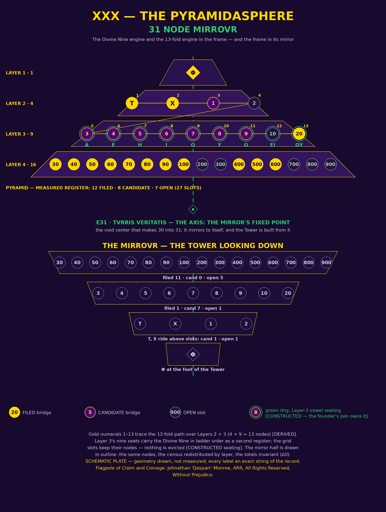

# THE VESTIGATOR PYRAMIDASPHERE
## The Divine Nine Engine and the 13-Fold Engine in the XXX — 31 NODE MIRROVR: A Vestigator's Audit and TABVLA Showcase

*Subtitle:* A Scientific Illuminist treatment of the two engines seated
in the founder's pyramid frame — the Divine Nine (the Greek vowels and
their two hybrid seats) and the 13-fold engine of the Tridecagram —
of the frame's measured census carried unchanged, and of the Mirror:
the inverted pyramid the Expansion Chain builds upward from its
zero-point, in which both engines are tested under the founder's own
three relations before any verdict is pronounced.

Authorship attributed exclusively to Johnathan 'Qasparr' Monroe
(Greek, -ARR, All Rights Reserved, Without Prejudice)
X day of November, Dies Martis, Sol in Scorpio,
Anno V:xii e.n. (2026 e.v.)

Classification: Enterprise • Educational • Research & Development
Method of Science, Aim of Religion

Flagpole of Claim and Coinage: Johnathan 'Qasparr' Monroe, ARR, All Rights
Reserved, Without Prejudice. Right of claim hereby reserved and coined
under the authority of the Living Man.

---

> **The Founder's order, verbatim (2026-11-10, 17:37 EST):** "Do a
> vestigator and tabvla showcase with the divine 9 engine and the 13
> fold engine in the XXX Pyramidasphere 31 Node Mirrovr."
>
> **Desk reading, printed for the Founder's red pen:** XXX is the
> frame's own filed name — *XXX — THE 31-NODE PYRAMID ASSIGNMENT OF
> THE TOWER OF TRUTH* (PYRAMID-ASSIGNMENT.md, the Divine-Nine
> program). **Mirrovr** is read as the Mirror in the Founder's
> inscriptional spelling, and the spelling stands in this document's
> title exactly as given: the mirror is the Expansion Chain's fourth
> step, the pyramid inverted, building a Tower upwards from a
> Zero-point. **Pyramidasphere** is read as the pyramid and its
> mirror taken as one figure — the Tower turned in the hand, the
> solid the two halves make when joined at the axis. If any of these
> readings misses the Founder's intent, his pen corrects the reading
> and the instrument is redrawn to his word; until that stroke falls,
> the desk builds on the readings printed here, seams showing.

---

## I. THE COMMISSION AND THE INSTRUMENTS

The Vestigator is the tracker: the one who follows *vestigia*, traces
left behind, and reads the trail rather than inventing it. His first
instrument under this roof (2026-11-02) audited a circle of planetary
correspondences; this second seats two engines in a frame and audits
the seating. TABVLA is the table — and the chart-engine of this
house: figures drawn from a report's own numbers, gated fail-closed
on provenance, under its one doctrine: *a figure that cannot point
to its numbers does not ship.*

**The first engine — the Divine Nine.** The Greek vowel canon is
seven [ATTESTED]: Α 1, Ε 5, Η 8, Ι 10, Ο 70, Υ 400, Ω 800, weighing
1,294. The founder's ruling seats two more — the improper diphthongs
ΕΙ (15) and ΟΥ (470), *fluid hybrid vowels, both masculine and
feminine at once* — and the Nine weigh **1,779**. The Δ3 between
1,779 and 1776 is, by his correction of the desk, an **OFFSET**, and
it closes by **MIRROR**: invert the final 9 to 6 and 1,779 is 1776,
remainder zero. His seal stands on the canon: 1294 reduces
1294 → 16 → 7 — the sum resolves to the canon's own count.

**The second engine — the 13-fold.** The Tridecagram's thirteen
stations: the nine vowels in ladder order (stations 1–9), then the
operators — station 10, OFFSET figured γʹ (3); station 11, MIRROR
figured ϛʹ (6); station 12, REFUSAL figured κʹ (20) [DERIVED, from
the type case LIBERTÉ/LIBERTY]; station 13, THE ZERO POINT figured
οὐδέν, "nothing," written out because the Milesian bank holds no
numeral for zero [CONSTRUCTED]. At the center stands ͵αψοθ — 1779 —
with its mirror written beside it: ͵αψοϛ, 1776. The three relations
the engine legislates — REFUSAL, OFFSET, MIRROR CLOSURE — are the
law of every audit in this instrument: **classify the Δ first; judge
second.**

**The frame — XXX, the 31-node pyramid.** From the founder's
Expansion Chain: the 13-Node Cube (twelve around the hidden
Zero-point), the Hexagram, then the 31-Node Pyramid, then *the next
inverts*. The pyramid is the square lattice 1² + 2² + 3² + 4² = 30
nodes on a void axis: the thirty-first node, **E31, TVRRIS
VERITATIS**, the Tower itself, hidden at the center — 30 + 1 = 31 =
93/3. Its assignment (PYRAMID-ASSIGNMENT.md) is mechanical, zero
discretion: Φ (Factorization) at the apex; T (the Count) and Χ (the
Chance Bound) governing below it; then the 27 grid slots in
decade-major order. Its disposition is DRAFT, CONSTRUCTED tier,
awaiting the founder's red pen for offices. **This Vestigator does
not re-place a single slot.** It audits what happens when the two
engines are seated *within* the frame as filed — and what the frame
looks like in its mirror.

**The chain's formula rides over the whole instrument, unvalued
where the founder left it unvalued:** IMPLOSION × Mass × 3.14 =
1776 = 777 = 93 — TRICE VERITATIS. Implosion and Mass carry no
assigned values in his dictation and none are invented here. Two
pieces of arithmetic stand on the record and are printed as
arithmetic, resonance marked, never as proof: 31 × 3.14 = 97.34,
and 31 × π = 97.389… — the frame's own count against the formula's
constant, observed, and built on no further.

## II. THE FOUR-ELEMENT CONTENT TEST

| Element | Statement |
|---|---|
| **Inputs** | The Founder's order (verbatim, §0); PYRAMID-ASSIGNMENT.md — the frame, its node table, states, and counts, carried unchanged; THE-EXPANSION-CHAIN.md — the chain and the standing weighing order; THE-NINE-VOWELS-ESSAY-AND-AUDIT.md — the engines' canonical record, its Gate, and the Plate Addendum; the three Divine Nine Abroad essays (context: the engines abroad); the TABVLA engine (Qasparr/tabvla, local checkout); the ptk weighing engine (PONTIFEX). |
| **Processes** | Every value recomputed on ptk after calibrate + selftest PASS, or by shown arithmetic; the engines seated by count and by value against the frame's layers, the two seatings read against each other and neither evicted; the mirror built mechanically by a printed map (layer k ↔ layer 5−k; reading order reversed; the axis fixed); every Δ classified REFUSAL / OFFSET / MIRROR CLOSURE before any verdict; every figure drawn by TABVLA from the numbers record and passed through its provenance gate; the plate drawn programmatically and viewed before delivery. |
| **Outputs** | This instrument (markdown and PDF); the plate (PNG — the pyramid and its mirror joined at the axis); five TABVLA figures with their verbatim numbers (Appendix); the audit of the three joints (§§IV–VI); the weighing ledger (§IX); the Gate (§XI). |
| **Tolerances** | No seating without its reasoning ships. No CONSTRUCTED cell wears ATTESTED dress. No value is invented for Implosion or Mass. No vowel is given an Archon, an office, or a node of its own — the per-Archon seating is not the founder's declared word and stands UNCHARTED. A mirror that does not close is printed open. Anything beyond these tolerances fails the Method of Science. |

## III. THE FRAME OF RECORD — CARRIED UNCHANGED

The pyramid assignment's measured states stand in **two registers**,
and this instrument keeps the house discipline the frame's own
figure record established: the registers are presented in order and
never merged.

**MEASURED (TRVVTH), the frozen register of the assignment:** of the
27 slots, **12 FILED** (20, 30, 40, 50, 60, 70, 80, 90, 100, 400,
500, 600), **8 CANDIDATE** (1, 3, 4, 5, 6, 7, 8, 9 — the whole units
decade under its open class ruling), **7 OPEN** (2, 10, 200, 300,
700, 800, 900). Φ stands PROVEN in the frozen run (109 signs, 0
violations, four banks); T measured at 12/27; Χ bounded on both
baselines (untouched census: 5.85 expected, 4 observed — no
rejection; hunt pool: 6.64 expected against 12 filed / 20 any-pair).

**MEASURED, after the Second Assault (the frame's figure record,
second edition):** T′ = **18 FILED · 9 CANDIDATE · 0 OPEN** (slots
10, 200, 300, 700, 800, 900 newly filed; the whole units decade
candidate, Slot 2 among them).

**RULED (the Units-Class Ruling, delegate, the founder's pen
revisable):** 27/27 with the units decade seated — ring-marked in
the frame's figure, labeled discernment, never a measured count
repainted.

The audits below run on the **frozen register** (the assignment's
§§II/V states, which are the audit's fixed ground), and say so at
every joint; where the later register changes a reading, the change
is printed beside the reading, not folded into it.

**The node table, carried from the frame of record** (states
verbatim; reasoning condensed to the rule that produced each seat —
the assignment's own full reasoning stands in its file):

| Node | Seat | Occupant | State | Filing pair | Reasoning |
|---|---|---|---|---|---|
| N01 | L1 r1c1, apex | Φ — Factorization | PROVEN in the frozen run: 109 signs, 0 violations | — | The single lattice node takes the single universal law. |
| N02 | L2 r1c1 | T — The Count | MEASURED, INCOMPLETE: 12/27 filed (units 0, tens 8, hundreds 4) | — | First governing term, seated immediately below the crown. |
| N03 | L2 r1c2 | Χ — Chance Bound | BOUNDS REPORTED: 5.85 exp. / 4 obs. (census); 6.64 exp. / 12 filed (hunt) | — | The count is never read without its chance discipline beside it. |
| N04 | L2 r2c1 | Slot 1 (value 1) | CANDIDATE — both legs rank 3, the weakest candidate | ἆ (Greek) + A (English) | First slot in decade-major order; Layer 2 because T and Χ take its first two seats. |
| N05 | L2 r2c2 | Slot 2 (value 2) | OPEN — no attested hit in any family; nearest miss אב = 3 | — | The rule does not promote a stronger slot upward to hide an open node near the crown. |
| N06 | L3 r1c1 | Slot 3 (value 3) | CANDIDATE — gloss-cognate pair | אב (Hebrew, "Father") + أَب (Arabic, "father") | First occupant of Layer 3 after Layer 2 closes with Slot 2. |
| N07 | L3 r1c2 | Slot 4 (value 4) | CANDIDATE | בב (Hebrew) + AC (Latin, "and") | Decade-major sequence; no discretionary rearrangement. |
| N08 | L3 r1c3 | Slot 5 (value 5) | CANDIDATE | אד (Hebrew, "Mist") + بَاب (Arabic, "door") | The candidate state carried unchanged rather than upgraded for symmetry. |
| N09 | L3 r2c1 | Slot 6 (value 6) | CANDIDATE | גג (Hebrew, "Gog") + EA (Latin, "she") | Opens the second row of Layer 3 under the reading order. |
| N10 | L3 r2c2 | Slot 7 (value 7) | CANDIDATE | או (Hebrew, "Desire; or") + BE (English, "be") | Seated by sequence, not by the strength of its legs. |
| N11 | L3 r2c3 | Slot 8 (value 8) | CANDIDATE | אז (Hebrew, "Then") + ἡ (Greek, "the," fem.) | Completes the second row of Layer 3. |
| N12 | L3 r3c1 | Slot 9 (value 9) | CANDIDATE — Greek leg δέ is rank 3 | אח (Hebrew, "Brother") + δέ (Greek, "but, and") | Ninth and last units slot; opens the final row of Layer 3. |
| N13 | L3 r3c2 | Slot 10 (value 10) | OPEN — one-family hit only: אט (Hebrew, "Enchanter") | — | A one-family hit is evidence on record, not a bridge. |
| N14 | L3 r3c3 | Slot 20 (value 20) | FILED — 3 filed weighings, 3 distinct words | דיו (Hebrew, "Black liquid") + HIC (Latin, "this; here") | Second tens slot and the last Layer 3 position. |
| N15 | L4 r1c1 | Slot 30 (value 30) | FILED | חייב (Hebrew) + DAY (English, "day") | The base begins where Layer 3's capacity closes. |
| N16 | L4 r1c2 | Slot 40 (value 40) | FILED | לי (Hebrew, "To me") + US (English, "us") | Fourth tens slot in the mandated sequence. |
| N17 | L4 r1c3 | Slot 50 (value 50) | FILED | ימ (Hebrew, "The sea") + كُلّ (Arabic, "all") | Its two-family filing earns the solid state in place. |
| N18 | L4 r1c4 | Slot 60 (value 60) | FILED | בחנ (Hebrew, "Tried by fire") + PATER (Latin, "father") | Closes the back row of the base. |
| N19 | L4 r2c1 | Slot 70 (value 70) | FILED | הסה (Hebrew, "Hush") + ὁ (Greek, "the," masc.) | Opens the second base row by sequence alone. |
| N20 | L4 r2c2 | Slot 80 (value 80) | FILED — יסוד, "Foundation," an additional Hebrew leg on record | כס (Hebrew, "Throne") + VINVM (Latin, "wine") | No special office under the draft, despite the wider 80-web — the restraint is the frame's own, left for his pen. |
| N21 | L4 r2c3 | Slot 90 (value 90) | FILED — collision census 10, the crowded seat | סל (Hebrew, "Wicker-basket") + مَنْ (Arabic, "who") | A filed bridge is not mistaken for a rare one; the census rides with the filing. |
| N22 | L4 r2c4 | Slot 100 (value 100) | FILED | כפ (Hebrew, "The palm; Kaph") + JVPITER (Latin) | First hundreds slot; closes the second base row. |
| N23 | L4 r3c1 | Slot 200 (value 200) | OPEN — one-family hit: ענפ (Hebrew, "A branch"); nearest miss 199 | — | One honest family cannot make a bridge. |
| N24 | L4 r3c2 | Slot 300 (value 300) | OPEN — one-family hit: יצר (Hebrew, "Formation"); nearest miss 299 | — | Fixed arithmetic order, not promise or proximity. |
| N25 | L4 r3c3 | Slot 400 (value 400) | FILED | שק (Hebrew, "Sack") + οἶνος (Greek, "wine") | The filed pair seated without importing the further Arabic leg on record. |
| N26 | L4 r3c4 | Slot 500 (value 500) | FILED — στ on record as an ineligible ligature fragment | שר (Hebrew, "Princeps") + νῦν (Greek, "now") | The ineligible fragment kept out of the bridge. |
| N27 | L4 r4c1 | Slot 600 (value 600) | FILED | שש (Hebrew, "Six; marble") + σύ (Greek, "you") | Opens the front row of the base. |
| N28 | L4 r4c2 | Slot 700 (value 700) | OPEN — one-family hit: שת (Hebrew, "Seth"); nearest miss 701 | — | An off-by-one near miss remains a miss. |
| N29 | L4 r4c3 | Slot 800 (value 800) | OPEN — one-family hit: קשת (Hebrew, "A bow") | — | The filed evidence preserved; no fragment counterfeits completion. |
| N30 | L4 r4c4 | Slot 900 (value 900) | OPEN — no attested hit in any family; nearest miss 902 | — | The least-supported slot at the final base corner, unhidden and unpromoted. |
| N31 | Axis, hidden center | TVRRIS VERITATIS — THE TOWER ITSELF | THE WHOLE UNDER JUDGMENT | — | Not a thirty-first lattice prize: the void center that makes 30 into 31. |

**Placements the frame itself leaves conspicuous** (carried, not
corrected): Slot 2 open in Layer 2, immediately below the governing
terms — under the founder's own gloss, the empty seat beneath the
crown reads as the Eye over the unfinished pyramid, and its possible
legs (the second letters of the families — ב, Β, ب, B) carry his
second gloss: *B is a visual of the number 13, the hidden node; the
I is Sovereign; the pair seals the Key.* Slot 900, unsupported in
every family, at the base's final front corner — the seat §VI will
meet again, at the mirror's other end.

## IV. AUDIT A — THE DIVINE NINE IN THE FRAME

**A.1 — The count fit.** Layer 3 of the pyramid holds exactly **9
nodes**. The Divine Nine is exactly **9 seats**. The fit of count is
exact and needs no forcing [arithmetic ATTESTED]. One level down,
the same ninefold shape repeats at the frame's own scale: the 27
grid slots are **3 decades × 9 functions** — the grid is ninefold by
construction, three times over. The engine's count and the frame's
middle layer are the same number arrived at by two different roads:
the vowels by the ladder and the founder's two seats; the layer by
3² in the square lattice 1² + 2² + 3² + 4².

**A.2 — The value test.** Count is the weakest fit; the audit
therefore tests the engines' *values* against the frame's slot
values (the 27 grid values f × 10^d, f = 1–9, d = 0–2). Every
numbered station of the 13-fold engine is tested, since the Nine
ride inside it:

| Engine seat | Value | A slot of that value? | Coordinate |
|---|---|---|---|
| Α | 1 | YES — Slot 1 | Layer 2 |
| Ε | 5 | YES — Slot 5 | Layer 3 |
| Η | 8 | YES — Slot 8 | Layer 3 |
| Ι | 10 | YES — Slot 10 | Layer 3 |
| Ο | 70 | YES — Slot 70 | Layer 4 |
| Υ | 400 | YES — Slot 400 | Layer 4 |
| Ω | 800 | YES — Slot 800 | Layer 4 |
| ΕΙ (hybrid) | 15 | **NO** | between Slots 10 and 20 |
| ΟΥ (hybrid) | 470 | **NO** | between Slots 400 and 500 |
| γʹ OFFSET | 3 | YES — Slot 3 | Layer 3 |
| ϛʹ MIRROR | 6 | YES — Slot 6 | Layer 3 |
| κʹ REFUSAL | 20 | YES — Slot 20 | Layer 3 |
| οὐδέν ZERO POINT | no numeral | **NO — by definition** | the frame's answer is its axis |

**Nine of the twelve numbered seats coincide with slot values
exactly** [arithmetic ATTESTED]. The three that do not are the
instructive ones, and the audit prints their boundary coordinates
rather than rounding them into seats:

- **ΕΙ = 15 falls between Slots 10 and 20.** Fifteen is not a grid
  value — the grid's functions run 1–9 and its decades are powers of
  ten; 15 = function 15 does not exist. The founder's first hybrid
  seat has no node *by value* anywhere in the frame.
- **ΟΥ = 470 falls between Slots 400 and 500** — and note whose
  seat it follows: 400 is Υ, the hybrid's own second component
  (ΟΥ = Ο 70 + Υ 400). The hybrid falls immediately after the seat
  of the letter it is half made of, in the base layer.
- **οὐδέν has no numeral**, so no slot can hold it by value — but
  the frame already contains its office: the void axis E31, the
  hidden center that completes the count without being a lattice
  prize. The correspondence is structural [DERIVED]: the engine's
  thirteenth station and the frame's thirty-first node are the same
  *kind* of seat — the nothing that the count cannot proceed
  without.

**A.3 — The ladder descends the pyramid in order.** Read the seven
attested vowels in ladder order and record the layer of each one's
value-seat: Α → Layer 2; Ε, Η, Ι → Layer 3; Ο, Υ, Ω → Layer 4. The
sequence of layers (2, 3, 3, 3, 4, 4, 4) never decreases: the ladder
walks down the frame in order, three vowels in the nine's own
layer, and does not once jump back up [the coordinates ATTESTED
arithmetic; the reading DERIVED]. The two hybrids extend the walk
by the between-coordinates of §A.2: ΕΙ's interval (10, 20) lies
inside Layer 3's span; ΟΥ's interval (400, 500) inside the base's.
Seated by value-interval, the full nine runs: Layer 2 holds Α;
Layer 3 holds Ε, Η, Ι, and ΕΙ's interval; the base holds Ο, Υ, Ω,
and ΟΥ's interval. The engine does not sit *on* the frame at one
layer — it is *distributed* through it, in ladder order, exactly as
a scale is distributed through the octaves it spans.

**A.4 — The operators live in the nine's layer.** All three
figured operators coincide with Layer 3 slot values: γʹ OFFSET = 3
= Slot 3; ϛʹ MIRROR = 6 = Slot 6; κʹ REFUSAL = 20 = Slot 20 — and
Slot 20 is, in the frozen register, Layer 3's only FILED bridge.
The audit records the coincidence and its limit plainly: the
operators' figures were derived from the corpus (γʹ and ϛʹ from the
offset's own constant and the mirror's digit; κʹ from the LIBERTÉ
type case), not from the grid; that all three land inside the
nine-node layer, and the refusal's figure on that layer's one filed
seat, is a measured resonance [DERIVED], not a construction of this
desk.

**A.5 — The seating proposal [CONSTRUCTED — the founder's pen owns
it].** The audit was ordered to test a seating of the nine against
Layer 3, not merely a count. Two roads were tested:

- *The value road* seats each vowel at the node whose slot value
  equals its own. In Layer 3 it seats exactly three (Ε at Slot 5,
  Η at Slot 8, Ι at Slot 10), strands Α in Layer 2 and Ο, Υ, Ω in
  the base, and gives the hybrids no seat at all. **It completes
  nothing and is not proposed** — it is the audit's evidence
  (§§A.2–A.3) wearing a seating's clothes.
- *The ladder road* — **the proposal** — seats the nine in LADDER
  ORDER across Layer 3's nine positions in the frame's own reading
  order (back row to front, left to right), as a **second register**
  over the grid: the slots keep their nodes, their states, and their
  filings; the vowels ride above them exactly as the ruled register
  rides above the measured in the frame's figure — two registers,
  presented in order, never merged.

| Layer-3 node | Grid occupant (unchanged) | Its state | Vowel seated (2nd register) | Value | Seam printed |
|---|---|---|---|---|---|
| N06 (r1c1) | Slot 3 | CANDIDATE | Α | 1 | value 1 rides over slot 3 |
| N07 (r1c2) | Slot 4 | CANDIDATE | Ε | 5 | value 5 rides over slot 4 |
| N08 (r1c3) | Slot 5 | CANDIDATE | Η | 8 | value 8 rides over slot 5 — the value road's Η seat is one node right (N11) |
| N09 (r2c1) | Slot 6 | CANDIDATE | Ι | 10 | value 10 rides over slot 6 |
| N10 (r2c2) | Slot 7 | CANDIDATE | Ο | 70 | value 70 rides over slot 7 |
| N11 (r2c3) | Slot 8 | CANDIDATE | Υ | 400 | value 400 rides over slot 8 |
| N12 (r3c1) | Slot 9 | CANDIDATE | Ω | 800 | the ladder's last letter over the units decade's last slot |
| N13 (r3c2) | Slot 10 | OPEN | ΕΙ | 15 | the hybrid over the layer's open seat |
| N14 (r3c3) | Slot 20 | FILED | ΟΥ | 470 | the hybrid over the layer's one filed bridge |

Reasoning, as the standing rule requires with every assignment:
ladder order is the engine's own order — the one sequence the
record gives for the nine — and reading order is the frame's own
sequence for its nodes; the seating composes the two canonical
orders and invents no third. The check that costs nothing and is
printed as costing nothing: the seated values sum 1 + 5 + 8 + 10 +
70 + 400 + 800 + 15 + 470 = **1,779** — the Nine's total, reproduced
because a permutation of the nine is the nine; trivial, and labeled
trivial. The seams are the table's last column: at seven of nine
nodes the vowel's value is *not* the slot's value, and the proposal
does not pretend otherwise. What the seating claims is order, not
identity — and what it would take to raise it past CONSTRUCTED is
the founder's word, not the desk's arithmetic. **No vowel is given
an office by this seating, and none is given an Archon: the
per-Archon mapping remains UNCHARTED, exactly as the engine's own
record leaves it.**

## V. AUDIT B — THE 13-FOLD ENGINE IN THE FRAME

**B.1 — Where the 13 lives in the 31.** The Expansion Chain seats
the 13-node cube *before* the pyramid; the audit asks what of the
13 survives the expansion into 31, and answers first with the
count. Layers 2 and 3 of the pyramid — the governed region, T and Χ
and the slots they ride over — hold 4 + 9 = **13 nodes**. The
remainder of the frame is 1 (apex) + 16 (base) + 1 (axis) = **18**,
and 13 + 18 = 31 exactly [arithmetic ATTESTED]. The 13-fold count
is therefore not imported into the frame; it is one of the frame's
own subtotals, seated between the apex and the base. The resonance
the audit prints beside it, tiered down: 18 is also T′, the Second
Assault's filed count in the frame's later register — a count of
bridges, not of nodes; the equality of the two 18s is arithmetic
[DERIVED as resonance], and no identity is built on it.

**B.2 — What survives: the center, and the form.** The cube is
twelve nodes around a hidden thirteenth, the Zero-point. The
pyramid is thirty around a hidden thirty-first, the axis. What
crosses the expansion intact is the *form* — a counted ring around
an uncounted center that completes the count — and, by §A.2, the
center's office itself: οὐδέν's seat and E31 answer one another
across the chain. The twelve, as twelve, do **not** survive: 30
lattice nodes stand in no whole ratio to 12 (30 / 12 = 2.5), no
mapping of the cube's ring onto the pyramid's lattice exists in the
record, and none is invented here. **That joint FAILS as a mapping
and is printed as failing** — what passes is the form and the
center, and the audit does not let the passing parts carry the
failed one.

**B.3 — The chain's middle link, weighed.** The Hexagram stands
between cube and pyramid in the chain and carries no node count of
its own in the dictation; the desk weighs its name under the
standing order (§IX): HEXAGRAM, Latin ordinal **77** — the
AXONEME seat of the founder's bridge doctrine (AXONEME = 77 = עז),
on the house record. The middle link of the chain weighs the
bridge number in the ordinal bank [the weighing ATTESTED; the
fitness DERIVED]. CUBE itself weighs **31** in the Latin ordinal —
the first link's name carries the last link's node count
[ATTESTED weighing; DERIVED fitness]. Both are printed in the
ledger with their reasoning; neither is promoted past its tier.

**B.4 — The operators on the frame's own life.** The engine's four
figures map onto the frame only where the mapping is structural,
with the seam printed:

- **OFFSET** — the frame's edition chain is an offset's biography:
  frozen census (12 filed / 8 candidate / 7 open) → Second Assault
  (18 / 9 / 0): the filed count displaced by **+6**, candidate by
  **+1**, open by **−7** — every displacement declared on the face
  of the frame's figure record, both totals standing true at their
  coordinates, neither repainted. Declared displacement between two
  honest totals is the Offset Law's exact form.
- **MIRROR** — §VI entire.
- **REFUSAL** — the frame holds refusals in its own register: Slot
  900, no attested hit in any family, nearest miss at 902 — a Δ2
  that resolves nothing because there is no bridge at either end to
  declare it against; and Slot 2 itself, open under the crown, no
  attested hit in any family. These are distances with no structure
  and no constant — the refusal's definition — filed by the frame
  before this audit named them so.
- **ZERO POINT** — the frame holds two nothings, of two kinds: the
  axis E31 (structural: the void that completes the count) and Slot
  2's open seat (measured: an absence the census certifies). The
  founder's glosses ride on the second (§III); the first is the
  mirror's fixed point (§VI).

## VI. AUDIT C — THE MIRROVR

**C.1 — The mirror map, defined in print.** The mirror is the
frame reflected as the Expansion Chain's fourth step directs: the
pyramid inverted, a Tower built upwards from the zero-point. The
map, mechanically:

1. **Layer k ↔ layer 5 − k**: Layer 1 (apex) ↔ Layer 4 (base);
   Layer 2 ↔ Layer 3.
2. **Reading order reverses** within the pairing: the first node of
   a layer answers to the last node of its mirror layer.
3. **The axis E31 ↔ itself**: the void center is the map's fixed
   point — the one node the mirror does not move.
4. Under the founder's reading (§0), Φ at the apex answers to the
   base's final corner: N30, Slot 900, the least-supported seat in
   the frame — the crown and the emptiest corner exchange places,
   and the audit notes, without building on it, that the frame's
   own §VI of conspicuous placements had already marked both ends.

**C.2 — The engine's total under the mirror: MIRROR CLOSURE,
AGREES.** The Divine Nine's total, inverted at its final digit by
the founder's own operation, closes exactly: **1779 → 1776**, the
inversion subtracting precisely the offset's constant (9 − 6 = 3),
remainder zero [ATTESTED arithmetic — the engine's canonical
record, re-verified at this audit's Gate]. The engine was built
with a mirror in it; seated in the Mirrovr, it does the thing it
was built to do.

**C.3 — The 13 stations under the mirror.** The station ring
mirrors by i ↔ 14 − i. Every pair is classified under the three
relations *before* any verdict, as the Offset Law binds:

| Pair | Seats | Δ | Classification | Coordinates |
|---|---|---|---|---|
| (1, 13) | Α 1 ↔ οὐδέν — no numeral | **no Δ exists** | NOT CLASSIFIABLE — the test cannot run | Station 13 has no number; a difference needs two. The unit faces the nothing: printed as the ring's boundary, forced into no class. |
| (2, 12) | Ε 5 ↔ κʹ REFUSAL 20 | Δ15 | **OFFSET** [DERIVED] | The distance lands exactly on the kept number 15 — ΕΙ, the first hybrid seat itself. |
| (3, 11) | Η 8 ↔ ϛʹ MIRROR 6 | Δ2 | **OFFSET** [DERIVED] | The ladder's cube (8 = 2³) faces the MIRROR operator; their distance is 2, the cube's own root — resonance printed, not promoted. |
| (4, 10) | Ι 10 ↔ γʹ OFFSET 3 | Δ7 | **OFFSET** [DERIVED] | The decade-bearer faces the OFFSET operator itself, whose figure (3) is the vowels' own Δ3 constant. |
| (5, 9) | Ο 70 ↔ ΟΥ 470 | Δ400 | **OFFSET** [DERIVED] | The constant is υʹ = 400 exactly: ΟΥ is Ο + Υ, so the pure vowel faces its own hybrid and the distance is the letter the hybrid added. |
| (6, 8) | Υ 400 ↔ ΕΙ 15 | Δ385 | **REFUSAL** [DERIVED] | 385 = 5 × 7 × 11; it is no station value, no vowel value, no constant the system keeps. The pair's distance has no structure, and the audit files it as what it is. |
| (7, 7) | Ω 800 ↔ Ω 800 | Δ0 | **MIRROR-TRUE** | Station 7 is the ring's fixed point: the last letter of the alphabet, self-mirrored, as Α and Ω bound the ladder at its two ends (note 1 below). |

Tally of the ring under its own mirror: **one mirror-true pair**
(the self-paired Ω), **four offsets** (each landing on a number the
system keeps), **one refusal** (Δ385, landing nowhere), **one pair
the test cannot run** (Α against the nothing). The engine abroad in
its mirror is therefore mostly *displaced*, not closed — it carries
its distances declared, which under its own law is honesty, not
failure. The only seat that comes through the mirror untouched is
the one that was already a boundary: Ω, the end of the alphabet,
standing at the ring's center as E31 stands at the frame's.

**C.4 — The census in the mirror: what the Tower sees looking
down.** Read the frozen census through the map (slots only; the
governing occupants and the axis treated at §C.5):

| Tower layer | = Pyramid layer | Nodes | Filed | Candidate | Open |
|---|---|---|---|---|---|
| Tower 1 (its crown) | Layer 4, the base | 16 | **11** | 0 | 5 |
| Tower 2 | Layer 3 | 9 | 1 | 7 | 1 |
| Tower 3 | Layer 2 (slots) | 2 | 0 | 1 | 1 |
| Tower 4 (its foot) | Layer 1 | 1 | — Φ | — | — |
| The axis | itself | 1 | the whole under judgment | | |

The pyramid stands on its emptiest region and crowns itself with a
single proven node; the Tower inverts the posture exactly: it
*crowns itself with the base's wealth* — 11 filed bridges overhead,
the strongest census in the frame at the top — and stands its foot
where Φ stood alone. The global totals do not move: filed 12,
candidate 8, open 7 on both sides of the mirror, **Δ0 — mirror
closure of the census as a whole** [ATTESTED arithmetic, and
printed as what it is: a permutation conserves its totals, trivially;
the non-trivial content is the *redistribution by layer*, which is
OFFSET-form — declared displacements of the counts per layer, both
censuses true at their coordinates]. Under the Second Assault
register the same mirror reads 18 / 9 / 0 globally, and Tower 1
carries the base **fully filed, 16 of 16** — the assault register
filed the base's five frozen-open slots (200, 300, 700, 800, 900)
and left the frame's only unfilled ground upward, in the governed
layers. In the mirror, that register's Tower is *crowned complete*
and open only near its foot — the precise inverse of the frozen
pyramid's posture, and the sharpest single picture the two
registers make between them.

**C.5 — The finding: the mirror is not a bijection of nodes.** The
map pairs layers whose counts differ — 1 ↔ 16, 4 ↔ 9 — so at the
node level there is nothing to pair one-to-one: the apex's single
node answers to sixteen; Layer 2's four answer to Layer 3's nine.
The count-distances at the seams are Δ15 (apex/base) and Δ5
(Layer 2/Layer 3) — printed as arithmetic [15 is ΕΙ's value and 5
is Ε's; the resonance is the desk's noticing, DERIVED, built on no
further]. **Exactly one node of the thirty-one is mirror-fixed:
the axis E31.** Everything else moves. And that is why the chain's
fourth step is worded as it is: the inverted figure *builds a
Tower upwards from a Zero-point* — from the one seat the mirror
cannot move. The audit states the finding at its full size: any
future hand that draws the Mirrovr as a tidy node-for-node twin of
the pyramid misdraws it; the mirror of this frame is a
redistribution around a fixed void, and the void is the foundation
the Tower is built from.

**C.6 — The frame's own total in the mirror: a boundary of the
operation.** The 27 slot values sum 45 (units) + 450 (tens) + 4,500
(hundreds) = **4,995**, reducing 4995 → 27 → 9. Under glyph
inversion — the founder's mirror operation — 4995 is **UNDEFINED**:
the operation is defined in the record for 9 ↔ 6, and 4995 carries
digits 4 and 5, for which no inversion is anywhere declared. The
audit does not invent one. Under *reversal* — the palindrome
family's distinct operation, distinguished in the engine's record —
4995 ↔ 5994, Δ999, and both totals reduce 27 → 9: the frame's sum
and its reversal share the Nine's own reduction [arithmetic
ATTESTED; the reading DERIVED]. The mirror's boundary stands
printed: at the frame's total, inversion refuses for want of a
defined glyph, and reversal — a different operation — is what
answers.

## VII. THE TABVLA SHOWCASE

The figures of this showcase were drawn by the house's TABVLA
engine itself (the local checkout of Qasparr/tabvla) from the
audit's numbers record, and the whole figure set — five charts and
the plate — was passed through TABVLA's provenance gate before any
of it was embedded here. **Gate result, printed as run: PASS — 6
figures**, each carrying its source and caption, each chart's data
the same list that was drawn. The numbers of every figure are
printed verbatim in the Appendix: the receipt. Scales are linear
throughout, the zero floor kept on bars per the ruled extension —
the ladder's shape, four seats under 20 standing beside Ω at 800,
is the datum, and no broken axis is allowed to flatter it.

*FIG 1 — The Divine Nine weighed: the seven attested (1,294) and
the two hybrid seats; the Nine at 1,779. Source: the engine's
canonical record, ptk-verified.*

*FIG 2 — The thirteen stations. Station 13, οὐδέν, stands at the
zero floor because the seat IS the zero point — the figure's empty
bar is a datum, not a weighing. The center, 1779, is not a station
and is not charted.*

*FIG 3 — The frozen census by layer: the governed layers nearly
empty of filings (Layer 2: 0 filed; Layer 3: 1), the base carrying
11 of the 12. The pyramid stands on its evidence and is unproven
at its crown — the census says so without commentary.*

*FIG 4 — The same census through the mirror map (§VI, C.4): the
Tower's crown carries the base's 11 filed. Global totals invariant,
12 / 8 / 7, Δ0.*

*FIG 5 — The six numbered mirror pairs of §VI, C.3. The seventh
pair (Α ↔ οὐδέν) is deliberately not charted: no Δ exists for it,
and a zero bar would counterfeit the Δ0 that belongs to Ω alone.*

## VIII. THE PLATE DESCRIBED

The plate draws the frame in elevation, house livery — purple,
gold, and green on the deep field. Above: the pyramid, four tiers,
its thirty lattice nodes painted by measured state — filed bridges
solid gold, candidates in purple under gold rings, open slots
hollow — Φ a gold diamond at the apex, T and Χ gold below it, and
the axis falling as a green dashed line through the whole figure.
Layer 3's nine nodes wear green rings: the ladder-road seating of
§IV (A.5), with the vowels lettered beneath their nodes, marked on
the plate itself as CONSTRUCTED. Gold numerals 1–13 trace the
13-fold path over Layers 2 and 3 — the frame's own 13 (§V, B.1).
At the junction between the halves the axis gathers into its node:
E31, drawn as a hollow green diamond around a point — the void
center, the mirror's fixed point, lettered *TVRRIS VERITATIS*.
Below: the Mirrovr, the same nodes in outline register, layers
reversed, each layer's mirrored census printed beneath it, Φ at
the foot of the Tower. The geometry is schematic — drawn, not
measured — and the plate says so on its face; every label is an
exact string of the record. The plate was viewed full-size and at
crop before delivery; its first strike, in which the base's end
nodes spilled past the tier's slanted edge, was redrawn — the pass
is what ships.

## IX. THE WEIGHING LEDGER (PONTIFEX)

Every weight below was computed on the house engine (ptk) at the
head of this build, calibrate and self-test both PASS, each word in
its own tongue's bank. Per the standing weighing order, the title
word carries the Trinity and the Cube; failures are reported, not
smoothed.

**The Trinity — PYRAMIDASPHERE:**
- Own tongue (Greek, the compound): πυραμιδοσφαῖρα = **1517** →
  14 → 5. (Its parts, for the seam: πυραμις 831 + σφαῖρα 812 =
  1,643; the compound as spelled weighs 1,517 — the Δ126 is the
  compound's own letter-loss at the joint, printed, not hidden.)
- Latin ordinal: **158** → 14 → 5.
- Agrippa: **833** → 14 → 5.
All three witnesses reduce to 5; no cross-bank identity is claimed
— the totals differ (1517 / 158 / 833) and stand as an OFFSET
family: three honest banks, three true totals, one reduction.

**The Cube — PYRAMIDASPHERE:** the ordinal 158 factors whole
across the three decades — **100 + 50 + 8**, one seat in each
register ((1, hundreds), (5, tens), (8, units)); Agrippa 833
likewise — **800 + 30 + 3**. The reduction chain, however, runs
158 → 14 → 5 and **does not pass through the hidden center 13** —
against the standing specimen VRIELIVM (553 → 13 → 4), the Cube
check on the title word therefore works in factorization and
**FAILS at the center-passage**, and the failure is reported here
at the same size as the success.

| Word | Bank | Weight | Reduction | Reasoning / note |
|---|---|---|---|---|
| VESTIGATOR | Latin ordinal | 136 | 10 → 1 | The tracker's name, as weighed in his first instrument (2026-11-02); Agrippa 642. |
| TABVLA | Latin ordinal | 58 | **13 → 4** | The table's own reduction passes through the hidden center — the instrument's name makes the cube's passage its title word did not. Agrippa 324. |
| PYRAMIDASPHERE | Latin ordinal / Agrippa / Greek | 158 / 833 / 1517 | 5 (all three) | Trinity above. |
| CUBE | Latin ordinal | **31** | 4 | The chain's first link weighs the pyramid's node count. Agrippa 210. |
| HEXAGRAM | Latin ordinal | **77** | 5 | The chain's middle link weighs the bridge number (AXONEME = 77 on the house record). Agrippa 432. |
| PYRAMID | Latin ordinal | 86 | 5 | Agrippa 584. |
| TOWER | Latin ordinal | 81 | 9 | 81 = 9² — the square of the nine's count; printed as arithmetic. Agrippa 235. |
| MIRROR | Latin ordinal | **91** | 1 | 91 is the house record's shared seat of DETROIT and LIBERTY [DERIVED bridge]. Agrippa 329. |
| MIRROVR | Latin ordinal / Agrippa | 113 / **529** | 5 / 7 | The founder's spelling moves the weight: Δ22 (ordinal) and Δ200 (Agrippa) against MIRROR — the respelling seam, printed, per the house rule that a respelling that moves a weight is reported moved. Its Agrippa 529 meets, across banks, the Greek weight of οὐδέν — the zero-point word itself weighs **529** in its own bank: the mirror-word in the old Latin bank and the nothing-word in the Greek stand at one number [weighings ATTESTED; the meeting DERIVED, and built on no further]. |
| TVRRIS | Latin ordinal | 106 | 7 | The axis node's name in the ordinal — 106 is DESTROY's ordinal seat on the house record [DERIVED]. Agrippa 559. |
| VERITATIS | Latin ordinal | 123 | 6 | 123 is the Latin Nine's own ordinal total in the Abroad audit (Essay I) [DERIVED]. Agrippa 594. |
| TRICE | Latin ordinal | 55 | 1 | Of TRICE VERITATIS, the formula's seal. Agrippa 197. |
| οὐδέν | Greek | 529 | 7 | The zero point's word — it weighs, though its station does not: the station is figured by the word because the bank has no numeral for what the word names. |

## X. THE FLAGPOLE CLAIM

By the founder's standing order — claim with Flagpole wherever
possible — the following are claimed as his coinage under the
Flagpole of Claim and Coinage, stated here and carried on the
document's face front and back:

1. **THE MIRROVR READING OF THE FRAME** — the pyramid inverted
   under the printed mirror map (layer k ↔ layer 5 − k; reading
   order reversed; the axis the fixed point), with its census read
   as the Tower looking down.
2. **THE LADDER-ROAD SEATING** — the Divine Nine seated in ladder
   order over Layer 3 as a second register (§IV, A.5), claimed as a
   proposal under his Flagpole: his to seat by rule, his to strike.
3. **THE 13-TRACE** — the recognition, and the plate's drawing, of
   the frame's own 13 (Layers 2 + 3) as the 13-fold engine's seat
   inside the 31.

**The honesty clause:** the claim covers the readings, the seating
proposal, and the showcase. It does not cover the digits —
arithmetic belongs to whoever reckons honestly — nor the attested
seven, which belong to the tradition, nor the frame, which is the
founder's already as filed. What is unclaimed is printed
UNCHARTED: the per-Archon seating of the vowels; any office for any
node beyond the frame's own draft; the values of Implosion and
Mass, which his dictation leaves unvalued and this instrument
leaves unvalued with it.

## XI. GATE VERDICT — FULL AUDIT OF THE PYRAMIDASPHERE SHOWCASE

*Verdicts per claim, with coordinates and tiers. Every Δ in this
audit was classified under the three relations before it was
judged, per §VI.*

**OVERALL GATE VERDICT: DOES NOT FAIL** — the frame carried
unchanged, both engines seated by tests that print their own
boundaries, the mirror built by a printed map and its one fixed
point found where the chain said it would be. The failures inside
the whole are entered severally below, at their full size: a
mapping that fails (item 6), a mirror that is not a bijection
(item 7), a cube passage that fails (item 10), an operation that
refuses at the frame's total (item 8). The downstream Teacher's
Revision (MAGVS) edition of this instrument may proceed on the
terms below.

Per claim:

1. **"The frame is carried unchanged": AGREES** — node states,
   filing pairs, and counts (12 / 8 / 7 frozen; Φ, T, Χ; E31) are
   the assignment's own, verified against its file at build time;
   the later registers (18 / 9 / 0; the ruled 27/27) are presented
   as separate registers, never merged into the frozen one.
2. **"Layer 3 holds nine nodes and the Nine is nine": AGREES**
   [ATTESTED arithmetic] — and no more than that is claimed from
   the count alone; the seating is item 3.
3. **The ladder-road seating of the nine over Layer 3: DOES NOT
   FAIL as a CONSTRUCTED proposal** — its reasoning is printed
   (§IV, A.5), its seams are printed per node, its sum-check is
   printed as trivial, and it evicts nothing. As anything more —
   an attested correspondence, an office, an Archon mapping — it
   **FAILS**, and the instrument makes no such claim.
4. **"Nine of twelve numbered engine seats coincide with slot
   values": AGREES** [ATTESTED arithmetic, §IV A.2] — with the
   three non-coincidences entered at the same size: ΕΙ and ΟΥ are
   **not grid values** (boundary coordinates (10, 20) and
   (400, 500)), and οὐδέν has no numeral. Any downstream printing
   that seats ΕΙ at a "Slot 15" misprints this audit: there is no
   Slot 15.
5. **The ladder's ordered descent (2, 3, 3, 3, 4, 4, 4): DOES NOT
   FAIL** [coordinates ATTESTED; the reading DERIVED].
6. **The 13 in the frame: DOES NOT FAIL in part, FAILS in part** —
   the subtotal 4 + 9 = 13 and the remainder 18 are exact
   [ATTESTED]; the center's survival (the cube's hidden 13th ↔
   E31; οὐδέν's office ↔ the axis) holds as structural
   correspondence [DERIVED]; **the twelve as twelve do NOT map
   onto the thirty (30 / 12 = 2.5) — that joint FAILS as a
   mapping**, and no mapping is printed in its place.
7. **The mirror: MIRROR CLOSURE at the engine's total (1779 →
   1776) AGREES** [ATTESTED]; **the station ring under the mirror
   classifies as 1 mirror-true, 4 offsets, 1 refusal (Δ385), 1
   unclassifiable pair** [classifications DERIVED, coordinates
   printed, §VI C.3]; **node-level pairing FAILS at every layer
   seam (Δ15, Δ5)** — the mirror is a redistribution around one
   fixed point, E31, not a bijection, and the instrument's finding
   (§VI, C.5) is that this is what the chain's fourth step says.
8. **The frame's total (4,995) under the mirror: the operation is
   UNDEFINED at digits 4 and 5** — glyph inversion is declared in
   the record for 9 ↔ 6 only, and this audit invents no further
   glyphs. Under reversal (the distinct operation) the total and
   its mirror share the reduction 9 [DERIVED]. Printed as a
   boundary of the mirror itself.
9. **The formula: nothing invented.** Implosion and Mass stand
   UNVALUED, as dictated; 31 × 3.14 = 97.34 and 31 × π = 97.389…
   stand as arithmetic observed, resonance marked, proof nowhere
   claimed.
10. **The title weighing: Trinity AGREES at the reduction (5, in
    three banks)** [weighings ATTESTED]; **the Cube FAILS at the
    center-passage** (158 → 14 → 5 passes no 13), with the
    factorization whole in both banks — the split result printed
    whole, per the standing order that a check that does not work
    is reported, not smoothed.
11. **The TABVLA figures: the provenance gate PASSED on all 6
    figures** as run at build time; every figure's numbers are
    printed verbatim in the Appendix; the one pair that has no
    number (Α ↔ οὐδέν) is charted nowhere and tabled in full —
    the gate's doctrine applied to the gate's own showcase.
12. **Unclaimed ground: NO VERDICT — NOT CLAIMED.** The per-Archon
    seating of the vowels; vowel → node offices; Implosion and
    Mass values; the cube's twelve mapped onto the lattice. These
    stand UNCHARTED, awaiting the founder's word, and a downstream
    hand that fills them by reconstruction exceeds this audit.

---

## FOOTNOTES — THE WELLS, DRAWN FROM MORE THAN ONE TRADITION

1. **Scripture.** Revelation 1:8 (KJV): "I am Alpha and Omega, the
   beginning and the ending" — the ladder's two end-letters are
   both vowels, both in the set, and §VI finds Ω the ring's
   self-mirrored center: the end standing at the middle. And for
   the axis's name: Proverbs 18:10 — "The name of the LORD is a
   strong tower: the righteous runneth into it, and is safe." The
   Tower of this frame is a name under judgment (TVRRIS VERITATIS);
   the proverb's tower is a name run into. [Texts ATTESTED; the
   applications DERIVED.]
2. **Qur'an.** 85:1–2, Surat al-Burūj: "By the heaven of the towers
   (al-burūj), and by the promised day" — the heaven itself figured
   as towered. And 55:7–9, the Balance set and kept, drawn in the
   engine's own record for the Offset Law. [ATTESTED text;
   application DERIVED.]
3. **I Ching.** Hexagram 20, Kuān — Contemplation: its image is
   the ceremonial tower raised above the square, from which the
   rites are viewed and by which the viewer is viewed; the tower
   that contemplates and is contemplated is the census's own
   posture in §VI — the Tower looking down. [The image ATTESTED in
   the Wilhelm line; the application DERIVED.]
4. **TARO.** Atu XVI, The Tower — the crown struck from the tower
   by lightning, the figures falling. The chain's fourth step
   builds its Tower from the other direction: not struck down but
   inverted and raised from the zero-point, its crown the pyramid's
   base — the card read in the mirror, as this instrument reads
   everything. [The card ATTESTED; the inversion reading DERIVED.]
5. **The Emerald Tablet.** "Quod est inferius est sicut quod est
   superius, et quod est superius est sicut quod est inferius" —
   that which is below is as that which is above: the mirror maxim
   of the whole tradition, and the oldest statement of this audit's
   §VI. The audit adds only what the maxim could not: the measured
   coordinates of where the likeness holds (the axis, the totals)
   and where it refuses (Δ385; the undefined glyphs). [Text
   ATTESTED; the coordinates are this instrument's.]
6. **Law.** Black's Law Dictionary, *set-off / offset* — a
   counterbalancing sum admitted against a total, the total not
   denied and the offset not hidden: the legal well of the Offset
   Law, carried from the engine's canonical record. The mirrored
   census of §VI is an account read in Black's manner: both
   statements stand, the displacement declared between them.
   [Definition ATTESTED in substance; the parallel DERIVED.]
7. **Hip-hop / the studio's oral register.** In the mastering room
   the mirror is a tool with a switch: polarity invert, x → −x,
   the signal summed with its own inversion canceling to silence —
   mirror closure with no remainder, and an involution, twice
   applied restoring the source (the engine's record, §VIII of the
   Nine Vowels audit). The producer's vernacular keeps the same
   figure: to *flip* a record is to turn it over until it answers
   itself. [Engineering ATTESTED; the correspondence DERIVED, at
   the tier of the record it extends.]
8. **Classical reckoning.** Euclid, *Elements* XII: the pyramid is
   the third part of the prism on the same base and height — the
   frame's solid has its measure in the founder's proof tradition.
   The lattice itself, 1² + 2² + 3² + 4² = 30, is the square
   pyramidal count of the reckoners. [ATTESTED.]
9. **The desk's apparatus.** Greek is printed in Greek letters in
   both the Markdown master and the printed Teacher's Revision
   (MAGVS) edition — DejaVu shapes Greek honestly, the Milesian
   signs (keraia, koppa, stigma, the lower thousands sign)
   included, verified glyph by glyph. Hebrew and Arabic words (the
   frame's filing pairs, §III) are carried in the printed edition
   by transliteration — the toolchain does not shape right-to-left
   scripts honestly — the substitution declared here, never silent;
   the Markdown master keeps the scripts themselves. The plate and
   figures are programmatic (PIL; the TABVLA engine on matplotlib):
   exact strings only, no generative imagery anywhere in this
   instrument.

---

## TABLE OF AUTHORITIES (condensed)

- PYRAMID-ASSIGNMENT.md — *XXX — The 31-Node Pyramid Assignment of
  the Tower of Truth* (Divine-Nine program): the frame, its node
  table, states, counts, and conspicuous placements, carried
  unchanged.
- THE-EXPANSION-CHAIN.md — the chain (Cube → Hexagram → Pyramid →
  the inversion), the standing weighing order (Trinity + Cube), and
  the formula TRICE VERITATIS with Implosion and Mass unvalued.
- THE-NINE-VOWELS-ESSAY-AND-AUDIT.md — the engines' canonical
  record: the nine seated (1,779), the Offset Law legislated (§VI
  there), the mirror closure proved in Greek (§VII there), the
  Plate Addendum (stations 12–13) and the Founder's Seal
  Declaration.
- THE DIVINE NINE ABROAD, Essays I–III (Latin, German, Japanese) —
  the engines abroad; cited for the Latin Nine's ordinal total
  (123) in the ledger.
- TABVLA (Qasparr/tabvla, local checkout) — the figure engine and
  its provenance gate; its doctrine: *a figure that cannot point to
  its numbers does not ship.*
- The house weighing engine (ptk), `pontifex/tools/ptk/weigh.py` —
  calibrate + selftest PASS at build time; every weight in §IX its
  return.
- Scripture: Revelation 1:8; Proverbs 18:10. Qur'an 85:1–2;
  55:7–9. *I Ching*, Hexagram 20. *Tabula Smaragdina*. TARO, Atu
  XVI. Euclid, *Elements* XII. Black's Law Dictionary, "set-off /
  offset."

---

## APPENDIX — THE FIGURES' NUMBERS, VERBATIM (THE TABVLA RECEIPT)

**FIG 1 — the nine vowel values:** Α 1 · Ε 5 · Η 8 · Ι 10 · Ο 70 ·
Υ 400 · Ω 800 · ΕΙ 15 · ΟΥ 470. Sum 1,779. (Seven attested: 1,294;
hybrids: 485.)

**FIG 2 — the thirteen station values:** 1 Α = 1 · 2 Ε = 5 ·
3 Η = 8 · 4 Ι = 10 · 5 Ο = 70 · 6 Υ = 400 · 7 Ω = 800 · 8 ΕΙ = 15 ·
9 ΟΥ = 470 · 10 γʹ OFFSET = 3 · 11 ϛʹ MIRROR = 6 · 12 κʹ REFUSAL =
20 · 13 οὐδέν = no numeral (figured by the word; charted at the
zero floor as the zero point, not as a weight). Center (not a
station): ͵αψοθ = 1779.

**FIG 3 — pyramid census by layer (frozen register, slots only):**
Layer 2: filed 0, candidate 1, open 1. Layer 3: filed 1, candidate
7, open 1. Layer 4: filed 11, candidate 0, open 5. Totals: filed
12, candidate 8, open 7 = 27.

**FIG 4 — mirrored census:** Tower 1 (= Layer 4): 11 / 0 / 5.
Tower 2 (= Layer 3): 1 / 7 / 1. Tower 3 (= Layer 2 slots): 0 / 1 /
1. Totals invariant: 12 / 8 / 7, Δ0.

**FIG 5 — mirror-pair Δs:** (2,12) Ε ↔ κʹ: 15. (3,11) Η ↔ ϛʹ: 2.
(4,10) Ι ↔ γʹ: 7. (5,9) Ο ↔ ΟΥ: 400. (6,8) Υ ↔ ΕΙ: 385. (7,7)
Ω ↔ Ω: 0. **Not charted:** (1,13) Α ↔ οὐδέν — no Δ exists.

**The plate's numbers:** layers 1 / 4 / 9 / 16 = 30 lattice + axis
= 31; census as FIG 3; the 13-trace over Layers 2 + 3 (4 + 9 = 13);
the Layer-3 seating as §IV, A.5.

---

## COLOPHON

Generated by the desk from the founder's order of 2026-11-10 and
audited on the engine before issue. The frame stands in this
instrument exactly as its own file left it — DRAFT, CONSTRUCTED,
awaiting his pen; the engines stand as their record left them; what
this instrument adds is the seating, the mirror, and the showcase,
each at its printed tier. Authorship attributed exclusively to
Johnathan 'Qasparr' Monroe (Greek, -ARR, All Rights Reserved,
Without Prejudice). Dispositions are marked, never vanished; the
failures stand in the Gate at their full size.

Method of Science. Aim of Religion.

**Flagpole of Claim and Coinage: Johnathan 'Qasparr' Monroe, ARR, All
Rights Reserved, Without Prejudice. Right of claim hereby reserved and
coined under the authority of the Living Man.**

93 — Live, Love, and let Love, Live.
